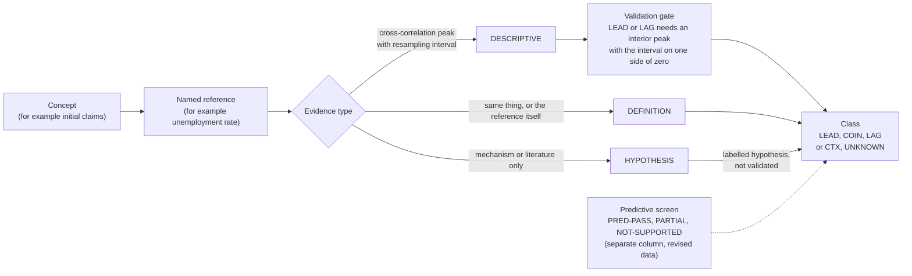

# Macro indicators: classification and storage

This page explains which macro indicators the hub tracks, how each is classified
(leading, coincident, lagging, context, not classified) and how each is tracked
in the database. It has two parts.

- **Part A** is written by hand: the method and the main findings behind the
  classification.
- **Part B** is generated from the indicator cards and the release catalogues.
  Do not edit it; run `python -m market_data_hub.indicator_cards.docs` and commit
  the result. See [Indicator cards](indicator-cards.md) for the card API and
  [Macro release contracts](macro-releases.md) for the official families.

## Part A: method and findings

This part summarises how the hub decides whether an indicator is *leading*,
*coincident* or *lagging*, how much that decision is worth, and what the tests
found. It is a summary of the owner-approved classification guide (version 2.1,
18 October 2026), its companion study guide and the research note behind it.
Each subsection ends with a **Source** line naming the section it summarises.
Every number below is quoted from those documents with its caveat. Nothing here
is a forecast or investment view.

*Reading the diagram.* A concept is always compared with a named reference. The
evidence behind the comparison is one of three kinds. Only a descriptive peak
goes through the gate, and only a peak that passes it supports a measured LEAD or
LAG label. DEFINITION rows are carried as stated; HYPOTHESIS rows may carry a
class but say "hypothesis" and are not validated. The predictive screen is a
separate question and does not change the class. CTX and UNKNOWN are the
outcomes where no timing claim is made.

### A1. The classes, and why timing needs a reference

| Class | Plain meaning |
|---|---|
| **LEAD** | Placed before the named reference. A timing claim, as a descriptive band, not a validated lead time. |
| **COIN** | Placed with the named reference (within about two months either way). A timing claim, as a descriptive band. |
| **LAG** | Placed after the named reference. A timing claim, as a descriptive band, not a validated lag. |
| **CTX** | Kept as context. We chose to use it that way and make **no** timing claim. |
| **UNKNOWN** | Not evaluated, or no supported relationship. Deliberately different from CTX. |

- **Timing is never absolute.** "Leading" means nothing without a reference and
  a transform, so every card reads like "LEAD vs US GDP". The tests show why. In
  the descriptive cross-correlations the 12-month change in unemployment lines up
  after industrial-production growth (pair Q17, peak at +3 months), while the
  unemployment level lines up before wage growth (Q20, peak at +16 months
  [10..24]). These are descriptions of alignment under one transform each, not
  lead times.
- **The bands are disjoint**: coincident is an estimated lead of −2 to +2 months,
  leading is more than +2 and lagging is less than −2. The band describes the
  estimate; the continuous estimate is always stored next to it.
- **References by theme.** Growth: real GDP and the NBER coincident set. Labour:
  the unemployment rate and payrolls. Inflation: the official target measure
  (headline PCE in the US, headline HICP in the euro area, headline CPI
  elsewhere); core measures are diagnostics. Monetary policy: the current policy
  state. Financial conditions and housing: a named activity series (IP, payrolls,
  unemployment or recession status).
- **A release lead is not an economic lead.** Tokyo CPI, member-state flash CPIs,
  IPCA-15 and Mexico's fortnightly CPI are published earlier but describe the
  same period, so they are COIN with a release-lead note.
- **Eight themes** organise the concepts: growth / activity, labour, inflation,
  monetary policy & rates, financial conditions & credit, housing, external /
  global, and fiscal & sovereign. A secondary tag records a cross-theme use (the
  broad dollar is External / global tagged Financial conditions).
- **Nature** says what kind of number it is: HARD (measured activity, prices,
  administrative records), SOFT (opinions, diffusion indices), MARKET (quoted
  prices), MARKET-DERIVED (fitted curves, term premia, composites such as NFCI;
  these are revised) and POLICY (central-bank decisions).

*Source:* classification guide §1.1, §1.2, §2.1.

### A2. DEFINITION, HYPOTHESIS and measured evidence

The **basis** of a class says where it comes from:

- **DEFINITION**: the row *is* the reference or a contemporaneous measure of the
  same thing (CPI against PCE inflation). No test is needed.
- **HYPOTHESIS**: an economic mechanism or published literature only. It is not
  validated here. A row can be a LEAD hypothesis even though a related pair passes
  the predictive screen (10y–2y and VIX): the screen does not establish a lag.
- **DESCRIPTIVE**: read from the peak of a cross-correlation between the row and
  its reference. For LEAD and LAG the build asserts that the peak is not at the
  edge of the search window and that its 5–95% resampling interval lies on one
  side of zero. It is still a description of how two histories line up, **not a
  validated lead time**.

Each row also carries **three separate evidence labels**, so that a reliable
statistic is not mistaken for a reliable timing:

1. *Measurement reliability* (H / M / L): issuer quality, coverage, revision
   size, known defects.
2. *Mechanism evidence* (strong / mixed / weak / n.a.): is there a documented
   economic channel?
3. *Timing evidence for that country, target and transform*: our own tests
   (`v2-pred-pass`, `v2-pred-partial`, `v2-pred-not-supported`, `v2-descriptive`,
   US data only), published local evidence (`lit-local`), US literature only
   (`lit-US`), a hypothesis carried over from the US (`analogy`), or `none`.
   **Non-US timing is a hypothesis unless there is local evidence.**

*Source:* classification guide §1.1, §1.3.

### A3. The validation gate: the predictive screen

Separately from the class, each tested pair gets a **predictive screen**: does
the candidate X add information about the *change* of the reference Y after the
forecast date, over 3, 6 and 12 months (1, 2 and 4 quarters)? The screen was fixed
before the v2 results were read (the authors' statement; there is no timestamped
protocol). The regression is the forward change of Y on X plus Y's own past
change, with the COVID windows removed. The outcome is:

- **PRED-PASS** if all three legs hold: (a) the coefficient has the expected sign
  with an approximate HAC |t| of at least 2; (b) the sign is the same in every
  subperiod with at least 36 monthly (24 quarterly) observations, and at least
  two subperiods qualify; (c) the expanding-window out-of-sample R² against an
  own-past model is positive, after at least 120 monthly (40 quarterly) training
  targets.
- **PRED-PARTIAL** if (a) holds but (b) or (c) fails.
- **PRED-NOT-SUPPORTED** if (a) fails. This says the specification failed, not
  that no useful relationship exists.

**A pass is a screening label, not a validated forecast.** It does not imply a
statistically significant out-of-sample improvement (no Clark–West test was
run), real-time availability, a causal mechanism or a lead in months. It does not
validate the lag of the descriptive peak either: the two use different
estimands. The guide's own example is building permits → housing starts (A3),
whose descriptive peak is at k = 0 yet which passes the screen at 12 months.
Multiple testing is **not corrected**: 42 pairs × 3 horizons = 126 overlapping,
dependent pair–horizon tests.

How to quote a result: predictive content as "passes at h = …"; a peak, if at
all, as "descriptive peak k [interval]", never as "X leads Y by k months".

*Source:* classification guide §1.3, §4.2 (how to quote).

### A4. Real-time versus revised data

- **All v2 statistics use latest-vintage (revised) data.** That is not "final"
  data. A backtest on revised numbers can overstate real-time usefulness, and the
  bias has no guaranteed sign. The one real-time input is the official
  real-time Sahm series.
- A real-time information set is defined by **release times**, not by reference
  periods: last month's industrial production may be unpublished while this
  month's market prices are known.
- Four times must be kept apart: the reference period, the release time, the
  vintage date, and when *we* ingested the value. `first_seen` in the hub's
  vintage table is an ingestion time, not a first print.
- **The vintage effect is visible.** The Sahm rule reads 0.47 in real time in
  2003-07 and 2003-08 but 0.50 on today's data; in 2024-07 it is 0.53 in real
  time and 0.50 on today's data. The same month can be a signal in one vintage
  and not in the other.
- The recession models train on labels lagged by an extra 12 months. That is a
  **heuristic** for the NBER announcement delay (4 to 21 months historically),
  not a guarantee about what was known.
- A real-time test is possible with ALFRED and archived releases but is not built
  yet (gap G-R1). Mixed vintages are worse than either pure vintage: the hub's
  retail-sales series (RSAFS) is the example (see A7).

*Source:* classification guide §1.4, §4.1; study guide §2.

### A5. What the tests found (US data only)

**Pairs.** The guide tests 42 pairs. 21 of them pass the predictive screen at one
or more horizons, and 35 of the 126 pair–horizon tests pass. These are different
denominators, and the tests overlap. By theme:

- *Curve.* The 10y–3m spread on long history (1959+) adds information for IP
  (A11, passes at 3, 6, 12 months) and payrolls (A12, 12 months). On the shorter
  hub sample the 10y–3m screens are only partial or not supported (Q1–Q3, Q5);
  10y–2y passes for payrolls at 12 months (Q4) but with a descriptive peak at the
  edge of the search window, so no lag is identified.
- *Credit and financial conditions.* The 6-month change in the Baa–10y spread
  passes for IP (Q9, 3 and 12 months) and unemployment (Q10, 12 months). NFCI and
  VIX pass for IP at 3 months only (Q11, Q13). The excess bond premium passes for
  IP and unemployment (A9, A10), and SLOOS C&I tightening for C&I loans (A8).
- *Housing.* Starts pass for payrolls (Q15, 12 months) and unemployment (Q16);
  permits pass for starts, payrolls and IP (A3–A5).
- *Labour.* IP growth passes the screen for the unemployment change at 3 months
  (Q17); the descriptive cross-correlation peak is at +3 months [2..5], which is
  an estimate of alignment, not a forecast or a lead time. The unemployment level
  passes for wage growth at 3, 6 and 12 months (Q20). Initial claims pass for unemployment (A1, all three
  horizons) and payrolls (A2, 12 months). Manufacturing hours pass for payrolls
  at 12 months (A6).

The descriptive peaks are searched over −24 to +24 months with a moving-block
bootstrap (24-month blocks, 400 draws) giving a 5–95% **sensitivity interval**.
Its coverage is not established. A collapsed interval such as [24..24] means the
search keeps hitting its boundary, not that the lag is exact.

**What was dropped or downgraded from the first version (v1).**

| v1 claim | v2 result |
|---|---|
| Curve leads by 27–32 months; "broke after 2013" | Removed. The edge peak is not a lead; long-history screens pass (A11, A12). |
| Brent leads headline CPI by about 1 month | Peak inside the coincident band; forward test not supported (Q22): COIN. |
| Housing starts lead IP | Screen not supported (Q14): not quoted. |
| Fed reacts to core PCE with a 3–8 month lag | Not supported; the sign flips once own past is controlled (Q29). Policy rows are CTX. |
| NFCI leads payrolls by 8–9 months | Only partial (Q12): not quoted. |
| Core capex orders lead IP by 2–6 months (literature) | Not supported, peak coincident (A7). |
| Any non-US lead (Ifo, ZEW, factory orders, Korean exports, PMIs, credit impulse) | Not tested locally: HYPOTHESIS only. |

**Recession probits.** Monthly and quarterly probit models of NBER recessions (11
peaks, 1953-07 to 2020-02) from the 10y–3m spread, the excess bond premium (EBP)
and a near-term forward spread, scored out of sample (from 1985, from 1990 for
EBP) with Brier skill (positive = beats a base-rate benchmark), log score and
AUC (ranking). Results:

- *Ranking is above chance:* AUC 0.63–0.89 across models. But there are few
  recessions and the months within an episode are correlated, so stability across
  independent episodes is not established.
- *Calibration is weak for "in recession exactly 12 months later" (target A).*
  The spread-only model does not beat the base rate on Brier skill (−0.016,
  1985-01 to 2025-09, 489 months, 36 event months, AUC 0.78), though it does on log
  score. Its whole highest-probability bin (0.50 to 1.00) is 20 origin months in
  2023–24 (two runs of 9 and 11 months) in which the observed frequency was 0.0.
  These are correlated months of one episode, not 20 independent misses.
- *Target B ("any recession in the next 12 months")*, scored on common origins
  from 1990: spread + EBP has Brier skill 0.215 and EBP alone 0.264, the spread
  alone −0.032. This is a descriptive comparison of point scores, not an
  identified contribution of EBP.
- *Quarterly:* our approximation of the near-term forward spread has small
  positive skill (+0.035); the 10y–3m does not (−0.064). This differs from the
  published result and should be treated as a property of the approximation.
- **A fitted probability is not a validated forecast.** Data are revised, events
  are few, the label lag is a heuristic and the quarterly origins are chosen on
  the ex-post recession state. A target-A probability concerns recession status
  exactly twelve months later, not "a recession in the coming year".

**Inversion episodes.** Episodes of an inverted curve are separated by at least 6
non-negative months. Of 12 episodes followed by an NBER peak (two spread
definitions, so episodes overlap), the curve un-inverted before the peak in 6 and
after it in 6, in a range of −11 to +34 months (peak minus exit). There is no
fixed exit rule. The inversion that began in 2022-11 had no NBER peak announced
through 2026-09 (data end), so at the 12- and 24-month horizons it is a **miss**;
the horizon is not extended. The 1966 inversion also fails at 24 months.

**Sahm rule.** It is a near-coincident detector, not a leading signal. The 7
matched real-time new signals (1969 to 2020) were dated −2 to +4 months from the
NBER peak (a description of past event timing, not a forecast). In 2024-07 it was a real-time signal with no recession. 2003 was *not* a
real-time trigger (0.47): the earlier "false positive" was a current-vintage
artefact.

*Source:* classification guide §3 (denominators), §4.1–§4.7, §1.5.

### A6. Why so many concepts are CTX or UNKNOWN

The skew is real and intended. Of the 270 concept rows (one per concept and
country or area; 47 countries and areas):

| Class | LEAD | COIN | LAG | CTX | UNKNOWN | Total |
|---|---:|---:|---:|---:|---:|---:|
| Rows | 11 | 64 | 7 | 120 | 68 | 270 |

- **CTX (120 rows)** is a decision, not a gap. Monetary-policy and rates rows are
  read against the current policy state (72 of the 76 are CTX); 29 of the 40
  external / global rows and all four fiscal rows are used as context. Annual panel levels are CTX "vs structure", one by
  one. A context row says "use this to understand the situation", not "this
  moves before or after X".
- **UNKNOWN (68 rows)** means no supported relationship has been shown. 25 are
  hypotheses (mechanism or literature only) and 43 have no
  evidence at all.
- **Calendar indicators.** When the calendar store was reviewed, its 655 tier-2
  and tier-3 rows were given a corrected theme and nature, and every one of those
  rows got timing UNKNOWN: no default timing is assigned by concept. A calendar id
  carries a class only after a manual mapping onto an approved concept row; it then
  carries that row's class. So some tier-2 ids are classified (for example
  industrial production, COIN, and housing starts, LEAD), and the rest stay
  UNKNOWN. The "Coverage notes" at the start of Part B give the exact counts for
  the calendar catalogue in this repository, derived from the data.
- **Our tests cover the US only.** Only 13 rows have a DESCRIPTIVE basis (6 LEAD,
  5 COIN, 2 LAG); 45 rows are COIN by DEFINITION and 49 are HYPOTHESIS. 249 of
  the 270 rows have no tested pair at all. Eleven rows have at least one
  relationship that passes the predictive screen; none of these passes is a lead
  time.
- By theme, UNKNOWN is concentrated in financial conditions & credit (18 of 30),
  growth / activity (19 of 39) and labour (15 of 27).

*Source:* classification guide §3 (tables by theme, basis and screen outcome),
§3.7, §1.3.

### A7. Known failure modes and limitations

- **Yield curve 2022–25**: see A5. A goods/rates tilt in composite indexes is an
  interpretation, not a demonstrated cause.
- **Conference Board leading index**: it signalled recession from July 2022 to
  January 2024 (19 months) and the recession forecast was changed in February
  2024.
- **Sahm rule**: near-coincident; 2024-07 was a signal with no recession.
- **Soft versus hard data**: there is no universal rule to weight hard data more.
  For measurement, definition and revisions matter; for prediction, validate the
  incremental forecast power.
- **COVID** is one of the three NBER recessions in the 2000+ hub sample
  (2001-03, 2007-12, 2020-02); removing it removes event evidence, and several
  results change with and without it.
- **Level versus change versus surprise**: a PMI of 48 rising from 46 is not the
  same signal as 48 falling from 52. Count independent channels, not variants of
  one series.
- **Remaining limits** (guide §4.7): revised rather than real-time data; HAC
  t-statistics are approximate; no significance test of out-of-sample gains; no
  multiple-testing correction; resampling intervals with no established coverage;
  few recessions; **matched turning-point leads are not estimated**; nothing is
  said about countries other than the US.
- **Data defects found** (nothing was changed in production): the hub's
  retail-sales series mixes vintages (41 of 321 months differ from the FRED current
  vintage by more than 0.5%; the Sep-2026 year-on-year growth reads 1.75% in the
  hub against 6.29% on a single vintage), so its recent growth rates are invalid
  until a full refresh; the `econ_state` key `ppi_final_demand` holds the finished-goods
  index (287.454) rather than headline final demand (159.78); euro-area
  unemployment in `macro_series` stops at 2023-01-01.

*Source:* classification guide §1.5, §4.7, §5.

### A8. The models behind it, in a few lines

- **Business cycles and turning points.** The NBER defines a recession as a
  significant decline in activity spread across the economy that lasts more than
  a few months, weighing depth, diffusion and duration. The peak month is the last
  month of the expansion. Announcements have come 4 to 21 months after the turn.
  So "leading" needs something to lead: dated turning points, which exist only
  after the fact, and only about a dozen in the US since 1953 (11 peaks).
- **Real-time data and revisions.** Most macro data are revised. A backtest on
  today's numbers asks whether something would have worked had we known the
  revised data, which is not the question a forecaster faces. Revised data usually
  flatter a backtest, but not always.
- **Indicators and composites.** Leading, coincident and lagging are relative
  descriptions of a series against a named reference. Composite indexes (the
  Conference Board's, the OECD's) average many series so that noise cancels,
  inverting countercyclical ones such as claims before combining. The Conference
  Board reads declines through duration, depth and diffusion. The OECD aims at a
  6 to 9 month lead on the growth cycle; that is its stated aim, not a measured
  property of every country. Studies using the vintages actually published found a
  composite's predictive ability much weaker in real time than on the final
  revised index, because the index is revised and its components were chosen with
  hindsight.
- **Four different questions.** A nowcast (current activity), a timing study
  (dated turns), a growth forecast and a recession-event forecast are separate
  targets. Success on one does not prove success on another: passing a
  growth-forecast test does not validate a timing statement.

*Source:* study guide, "The four questions", §1, §2, §3.

### A9. The research behind it

The classification starts from a comparison of how practitioners classify
indicators: the Conference Board leading, coincident and lagging indexes
(historically 10, 4 and 7 components for the US), the OECD composite leading
indicator, the NBER dating committee (six monthly coincident series), nowcasting
models such as the New York Fed Staff Nowcast and GDPNow, growth-and-inflation
regime frameworks and financial-conditions indexes. Three lessons were carried
over: timing is relative to a named reference; an indicator should have an
economic reason for its place (the OECD's four rationales: early-stage,
rapidly responsive, expectation-sensitive and prime movers); and revisions and
real-time availability must be taken seriously. The note grades its own evidence
as strong, mixed or weak and marks references it could not re-open. Its
typical-lead figures are approximate historical medians from the literature; the
v2 tests described above replace them where the hub could test them, and
otherwise the lead stays a hypothesis.

*Source:* research note §1, §2.1, §3 (general pitfalls).

## Part B: tracked indicators and where they are stored

Generated by `python -m market_data_hub.indicator_cards.docs` (check with
`--check`). The content comes from the cards in
`market_data_hub/indicator_cards/` and from `market_data_hub/macro_releases/`.

<!-- BEGIN GENERATED: macro-indicators -->

<!-- Generated by `python -m market_data_hub.indicator_cards.docs`; do not edit by hand. -->

### Summary by geography

| Geography | Concepts | Official cards | Consensus | LEAD | COIN | LAG | CTX | UNKNOWN (not classified) |
|---|---|---|---|---|---|---|---|---|
| USA (United States) | 81 | 21 | 21 | 8 | 14 | 2 | 21 | 36 |
| EA | 22 | 10 | 10 | 0 | 6 | 1 | 8 | 7 |
| CHN (China) | 18 | 1 | 1 | 0 | 6 | 0 | 5 | 7 |
| GBR (United Kingdom) | 17 | 8 | 7 | 0 | 6 | 1 | 4 | 6 |
| PANEL | 17 | 0 | 0 | 1 | 0 | 0 | 14 | 2 |
| JPN (Japan) | 12 | 1 | 1 | 0 | 6 | 0 | 4 | 2 |
| CAN (Canada) | 10 | 1 | 1 | 0 | 3 | 0 | 3 | 4 |
| DEU (Germany) | 9 | 0 | 0 | 1 | 4 | 1 | 1 | 2 |
| ITA (Italy) | 8 | 0 | 0 | 0 | 4 | 1 | 1 | 2 |
| AUS (Australia) | 7 | 0 | 0 | 0 | 2 | 0 | 3 | 2 |
| MEX (Mexico) | 7 | 0 | 0 | 0 | 3 | 0 | 3 | 1 |
| BRA (Brazil) | 6 | 0 | 0 | 0 | 2 | 0 | 4 | 0 |
| ESP (Spain) | 6 | 0 | 0 | 0 | 3 | 0 | 1 | 2 |
| KOR (Korea, Rep.) | 6 | 0 | 0 | 0 | 2 | 0 | 3 | 1 |
| TWN | 6 | 0 | 0 | 1 | 3 | 0 | 1 | 1 |
| FRA (France) | 5 | 0 | 0 | 0 | 2 | 0 | 1 | 2 |
| IND (India) | 5 | 0 | 0 | 0 | 2 | 0 | 2 | 1 |
| POL (Poland) | 5 | 0 | 0 | 0 | 2 | 1 | 2 | 0 |
| ARG (Argentina) | 4 | 0 | 0 | 0 | 2 | 0 | 0 | 2 |
| CHE (Switzerland) | 4 | 0 | 0 | 0 | 0 | 0 | 4 | 0 |
| ZAF (South Africa) | 4 | 0 | 0 | 0 | 0 | 0 | 4 | 0 |
| NZL (New Zealand) | 3 | 0 | 0 | 0 | 0 | 0 | 3 | 0 |
| SWE (Sweden) | 3 | 0 | 0 | 0 | 0 | 0 | 3 | 0 |
| BEL (Belgium) | 2 | 0 | 0 | 0 | 0 | 0 | 2 | 0 |
| DNK (Denmark) | 2 | 0 | 0 | 0 | 0 | 0 | 2 | 0 |
| EM | 2 | 0 | 0 | 0 | 0 | 0 | 0 | 2 |
| GLOBAL | 2 | 0 | 0 | 0 | 1 | 0 | 0 | 1 |
| NOR (Norway) | 2 | 0 | 0 | 0 | 0 | 0 | 2 | 0 |
| AUT (Austria) | 1 | 0 | 0 | 0 | 0 | 0 | 1 | 0 |
| CHL (Chile) | 1 | 0 | 0 | 0 | 0 | 0 | 1 | 0 |
| CZE (Czechia) | 1 | 0 | 0 | 0 | 0 | 0 | 1 | 0 |
| FIN (Finland) | 1 | 0 | 0 | 0 | 0 | 0 | 1 | 0 |
| GRC (Greece) | 1 | 0 | 0 | 0 | 0 | 0 | 1 | 0 |
| HKG (Hong Kong SAR) | 1 | 0 | 0 | 0 | 0 | 0 | 1 | 0 |
| HUN (Hungary) | 1 | 0 | 0 | 0 | 0 | 0 | 1 | 0 |
| IRL (Ireland) | 1 | 0 | 0 | 0 | 0 | 0 | 1 | 0 |
| ISR (Israel) | 1 | 0 | 0 | 0 | 0 | 0 | 1 | 0 |
| LKA | 1 | 0 | 0 | 0 | 0 | 0 | 1 | 0 |
| LUX (Luxembourg) | 1 | 0 | 0 | 0 | 0 | 0 | 1 | 0 |
| MYS (Malaysia) | 1 | 0 | 0 | 0 | 0 | 0 | 1 | 0 |
| NLD (Netherlands) | 1 | 0 | 0 | 0 | 0 | 0 | 1 | 0 |
| PRT (Portugal) | 1 | 0 | 0 | 0 | 0 | 0 | 1 | 0 |
| SGP (Singapore) | 1 | 0 | 0 | 0 | 0 | 0 | 1 | 0 |
| SVK (Slovak Republic) | 1 | 0 | 0 | 0 | 0 | 0 | 1 | 0 |
| SVN (Slovenia) | 1 | 0 | 0 | 0 | 0 | 0 | 1 | 0 |
| THA (Thailand) | 1 | 0 | 0 | 0 | 0 | 0 | 1 | 0 |
| VEN | 1 | 0 | 0 | 0 | 0 | 0 | 1 | 0 |
| **All** | 294 | 42 | 41 | 11 | 73 | 7 | 120 | 83 |

### Coverage notes

- Economic-calendar catalogue (`config/econ_calendar.yaml`): 160 entries (T1 65, T2 69, T3 26). 95 are tier 2 or 3: 21 of them map to an approved card and carry that card's class (1 LEAD, 7 COIN, 1 LAG, 3 CTX, 9 UNKNOWN); 74 map to no card and are not classified.
- Certified families in `macro_releases.catalogue.FAMILIES`: 40 (`us_cpi`, `us_payrolls`, `us_gdp`, `ea_hicp`, `uk_gdp`, `us_ppi`, `us_jolts`, `us_pce`, `us_retail_sales`, `us_housing_starts`, `us_durable_goods`, `us_industrial_production`, `us_trade_balance`, `uk_cpi`, `uk_labour_market`, `ea_gdp`, `us_jobless_claims`, `us_umich_sentiment`, `ea_ec_surveys`, `uk_total_pay`, `ea_core_hicp`, `us_new_home_sales`, `uk_retail_sales`, `ea_trade_balance`, `ea_industrial_production`, `ea_retail_sales`, `ea_unemployment`, `boj_policy`, `pboc_lpr`, `boc_policy`, `boe_policy`, `ecb_policy`, `fomc`, `ea_hpi`, `us_case_shiller`, `us_pending_home_sales`, `us_existing_home_sales`, `us_pmms`, `us_construction_spending`, `us_fhfa_hpi`).
- Families with no indicator card: `ea_hpi`, `us_case_shiller`, `us_pending_home_sales`, `us_pmms`, `us_fhfa_hpi`.
- Families the read API has no indicator map for: none.
- Catalogue indicators with no card alias: `ea21_hpi_qq`, `ea21_hpi_yy`, `us_case_shiller_20_yy`, `us_case_shiller_national_yy`, `us_fhfa_hpi_mm`, `us_fhfa_hpi_yy`, `us_pending_home_sales_mm`, `us_pmms_30y`.

How to read the tables:

- **Timing class vs reference** is the owner-approved class (`LEAD`, `COIN`, `LAG`, `CTX`) relative to the
  named reference, with its basis in brackets (`DEFINITION`, `HYPOTHESIS`, `DESCRIPTIVE`) when the card has
  one; `not classified` is `UNKNOWN`. Nature is `HARD`, `SOFT`, `POLICY`, `MARKET` or `MARKET-DERIVED`.
- **Evidence** is the card's local-timing label (`ev_timing`); `none` means no timing evidence is recorded.
- **Stores**: `macro_releases` is the certified official family, built from issuer editions, listing the
  catalogue indicator ids that map to the card. `ms:` is the hub `macro_series` table, `es:` the
  `econ_state.db` store named by the approved table (it is not part of this repository), `cal:` an economic-
  calendar indicator key (`calendar_indicators.indicator_key`; the tables `calendar_indicators`,
  `calendar_events` and `calendar_observations` live in the configured hub DuckDB database and are written by
  `run_econ_calendar.py` from the catalogue `config/econ_calendar.yaml`), `pan:` the cross-country
  `macro_panel`, `hub:` another hub table and `cat:` the planned catalogue (not downloaded). Ids are shown as
  recorded on the card; this page does not verify that each id is present in its store (see the coverage
  report). Some `cal:` ids come from the approved table and are not keys of the catalogue above. Notes copy
  the card's own gap annotations verbatim.
- **Issuer / source**: `issuer` is the original publisher named in the card's source column, with any
  redistributor removed; `—` when the source column does not name one. `certified issuer` is the issuer of the
  official family. `calendar agency` is the agency named by the calendar catalogue. `feed` is where the hub
  downloads from, or a redistributor named in the card's source column: FRED and ALFRED are redistributors,
  never the issuer.
- **Freq**: D daily, W weekly, 2W fortnightly, M monthly, Q quarterly, A annual, E scheduled events (policy
  meetings), as recorded on the card.
- **Release time**: local issuer time and zone from the reviewed edition calendars of the official family;
  `—` where no edition calendar holds it.
- **Official card**: the card maps to a family in `FAMILIES`. **Consensus**: an FF alias exists for it.
- **Tier**: the best (T1 highest) tier among the card's catalogue and calendar entries found in the repository
  catalogues; `—` when none is found.

### USA (United States)

| Concept (card key) | Theme | Timing class vs reference · nature | Evidence (`ev_timing`) | Stores | Issuer / source | Freq | Release time | Official card | Consensus | Tier |
|---|---|---|---|---|---|---|---|---|---|---|
| Advance goods trade balance (`us_adv_goods_trade`) | External / global | not classified HARD | none | cal: `us_advance_goods_trade_balance` | issuer: Census | M | — | no | no | — |
| Broad trade-weighted dollar (`us_dollar_broad`) | External / global | CTX vs core CPI MARKET | v2-pred-not-supported (US) | ms: `DTWEXBGS` | issuer: Fed H.10 feed: FRED (redistributor) | D | — | no | no | — |
| Current account (`us_current_account`) | External / global | CTX vs external balance HARD | none | cal: `us_current_account` | issuer: BEA | Q | — | no | no | — |
| Goods and services trade balance (`us_trade_balance`) | External / global | not classified HARD | none | **macro_releases** `us_trade_balance` (`us_trade_balance`) cal: `us_trade` cat: `us_trade_balance` | issuer: Census; BEA certified issuer: Census/BEA calendar agency: BEA / Census Bureau feed: FRED (redistributor) | M | 08:30 America/New_York | yes | yes | T1 |
| NY Harbor ULSD diesel spot (`us_diesel_spot`) | External / global | not classified MARKET | none | ms: `DDFUELNYH` | issuer: EIA feed: FRED (redistributor) | D | — | no | no | — |
| Baa minus 10y Treasury spread (`us_spread_baa10y`) | Financial conditions & credit | LEAD vs IP growth; unemployment [DESCRIPTIVE] MARKET | v2-pred-pass (US) | derived from ms: `BAA`, `DGS10` | issuer: Moody's; Fed Board | M | — | no | no | — |
| Baa minus Aaa spread (`us_spread_baa_aaa`) | Financial conditions & credit | not classified MARKET | none | derived from ms: `BAA`, `AAA` | issuer: Moody's | M | — | no | no | — |
| Chicago Fed NFCI (`us_nfci`) | Financial conditions & credit | LEAD vs IP growth [DESCRIPTIVE] MARKET-DERIVED | v2-pred-pass (US) | ms: `NFCI` | issuer: Chicago Fed feed: FRED (redistributor) | W | — | no | no | — |
| Fed total assets (`us_fed_assets`) | Financial conditions & credit | CTX vs market liquidity HARD | none | ms: `WALCL` | issuer: Fed H.4.1 feed: FRED (redistributor) | W | — | no | no | — |
| G.19 consumer credit (`us_consumer_credit`) | Financial conditions & credit | not classified HARD | none | cal: `us_consumer_credit` | issuer: Fed G.19 | M | — | no | no | — |
| H.8 bank credit (`us_bank_credit`) | Financial conditions & credit | not classified HARD | none | cal: `us_bank_credit` | issuer: Fed H.8 | W | — | no | no | — |
| H.8 loans and leases (`us_bank_loans_leases`) | Financial conditions & credit | not classified HARD | none | cal: `us_bank_loans_leases` | issuer: Fed H.8 | W | — | no | no | — |
| ICE BofA BBB OAS (`us_oas_bbb`) | Financial conditions & credit | not classified MARKET | none | ms: `BAMLC0A4CBBB` | issuer: ICE feed: FRED (redistributor) | D | — | no | no | — |
| ICE BofA CCC and lower OAS (`us_oas_ccc`) | Financial conditions & credit | not classified MARKET | none | ms: `BAMLH0A3HYC` | issuer: ICE feed: FRED (redistributor) | D | — | no | no | — |
| ICE BofA US corporate master OAS (`us_oas_ig`) | Financial conditions & credit | not classified MARKET | lit-US | ms: `BAMLC0A0CM` | issuer: ICE feed: FRED (redistributor) | D | — | no | no | — |
| ICE BofA US high yield OAS (`us_oas_hy`) | Financial conditions & credit | not classified MARKET | lit-US | ms: `BAMLH0A0HYM2` | issuer: ICE feed: FRED (redistributor) | D | — | no | no | — |
| M2 money stock (`us_m2`) | Financial conditions & credit | CTX vs CPI inflation HARD | v2-pred-not-supported (US) | ms: `M2SL` | issuer: Fed H.6 feed: FRED (redistributor) | M | — | no | no | — |
| Moody's Baa and Aaa corporate yields (`us_corp_yields`) | Financial conditions & credit | CTX MARKET | none | ms: `BAA`, `AAA` | issuer: Moody's feed: FRED (redistributor) | M | — | no | no | — |
| Overnight reverse repo (`us_on_rrp`) | Financial conditions & credit | CTX vs market liquidity HARD | none | ms: `RRPONTSYD` | issuer: NY Fed feed: FRED (redistributor) | D | — | no | no | — |
| St. Louis Fed Financial Stress Index (`us_stlfsi`) | Financial conditions & credit | not classified MARKET-DERIVED | none | ms: `STLFSI4` | issuer: St. Louis Fed feed: FRED (redistributor) | W | — | no | no | — |
| VIX (`us_vix`) | Financial conditions & credit | LEAD vs IP growth [HYPOTHESIS] MARKET | v2-pred-pass (US) | ms: `VIXCLS` | issuer: Cboe feed: FRED (redistributor) | D | — | no | no | — |
| Treasury General Account (`us_tga`) | Fiscal & sovereign | CTX vs market liquidity HARD | none | ms: `WTREGEN` hub: `treasury_cash_balance` | issuer: Treasury; Fed H.4.1 feed: FRED (redistributor) | W | — | no | no | — |
| Treasury debt outstanding (`us_treasury_debt`) | Fiscal & sovereign | CTX vs debt stock HARD | none | hub: `treasury_debt_outstanding` | issuer: US Treasury | M | — | no | no | — |
| Capacity utilisation (`us_capacity_util`) | Growth / activity | not classified HARD | none | **macro_releases** `us_industrial_production` (`us_capacity_utilization`) cal: `us_capacity_utilization` cat: `us_capacity_utilization` | issuer: Fed Board certified issuer: FederalReserve feed: FRED (redistributor) | M | 09:15 America/New_York | yes | yes | T1 |
| Conference Board consumer confidence (`us_conf_board_confidence`) | Growth / activity | not classified SOFT | none | cal: `us_consumer_confidence` cat: `us_conference_board_consumer_confidence` | issuer: Conference Board | M | — | no | no | — |
| Durable goods orders (headline) (`us_durable_orders`) | Growth / activity | not classified HARD | none | **macro_releases** `us_durable_goods` (`us_durable_goods_ex_transport_mm`, `us_durable_goods_orders_mm`) cal: `us_durable` cat: `us_durable_goods_orders_mm`, `us_durable_goods_ex_transport_mm` | issuer: Census M3 certified issuer: Census calendar agency: Census Bureau feed: FRED (redistributor) | M | 08:30 / 10:00 America/New_York | yes | yes | T1 |
| Factory orders (`us_factory_orders`) | Growth / activity | not classified HARD | none | cal: `us_factory` | issuer: Census M3 calendar agency: Census Bureau | M | — | no | no | T3 |
| ISM manufacturing PMI (headline) (`us_ism_mfg`) | Growth / activity | COIN vs IP [HYPOTHESIS] SOFT | lit-US | cal: `us_ism_mfg` cat: `us_ism_manufacturing_pmi` | issuer: ISM calendar agency: ISM | M | — | no | no | T1 |
| ISM services PMI (`us_ism_svc`) | Growth / activity | COIN vs services activity [HYPOTHESIS] SOFT | none | cal: `us_ism_svc` cat: `us_ism_services_pmi` | issuer: ISM calendar agency: ISM | M | — | no | no | T1 |
| Industrial production (`us_indpro`) | Growth / activity | COIN vs NBER coincident set [DEFINITION] HARD | v2-pred-pass (US) | **macro_releases** `us_industrial_production` (`us_industrial_production_mm`) ms: `INDPRO` cal: `us_indprod`, `us_indprod_yy` cat: `us_industrial_production_mm` | issuer: Fed Board certified issuer: FederalReserve calendar agency: Federal Reserve feed: FRED (redistributor) | M | 09:15 America/New_York | yes | yes | T1 |
| Nominal GDP (`us_gdp_nominal`) | Growth / activity | COIN vs real GDP [DEFINITION] HARD | n.a. | ms: `GDP` | issuer: BEA feed: FRED (redistributor) | Q | — | no | no | — |
| Personal income (nominal) (`us_personal_income`) | Growth / activity | not classified HARD | none | cal: `us_personal_income_mm` | issuer: BEA | M | — | no | no | — |
| Personal spending (nominal) (`us_personal_spending`) | Growth / activity | not classified HARD | none | cal: `us_personal_spending_mm` | issuer: BEA | M | — | no | no | — |
| Real GDP (`us_gdp_real`) | Growth / activity | COIN vs itself (growth reference) [DEFINITION] HARD | n.a. | **macro_releases** `us_gdp` (`us_gdp_qq_saar`) ms: `GDPC1` cal: `us_gdp`, `us_gdp_qq_third` es: `gdp_real_pct_change` cat: `us_gdp_qq_saar` | issuer: BEA certified issuer: BEA calendar agency: BEA feed: FRED (redistributor) | Q | 08:30 America/New_York | yes | yes | T1 |
| Retail and food services sales (nominal) (`us_retail_sales`) | Growth / activity | COIN vs IP (activity) [DESCRIPTIVE] HARD | v2-descriptive (US) | **macro_releases** `us_retail_sales` (`us_retail_sales_ex_auto_mm`, `us_retail_sales_mm`) ms: `RSAFS` cal: `us_retail`, `us_retail_yy`, `us_retail_ex_auto_mm` cat: `us_retail_sales_mm`, `us_retail_sales_ex_auto_mm` | issuer: Census certified issuer: Census calendar agency: Census Bureau feed: FRED (redistributor) | M | 08:30 America/New_York | yes | yes | T1 |
| S&P Global PMIs (flash and final) (`us_spglobal_pmi`) | Growth / activity | COIN vs GDP [HYPOTHESIS] SOFT | none | cal: `us_pmi_composite_flash`, `us_pmi_mfg`, `us_pmi_mfg_flash`, `us_pmi_svc`, `us_pmi_svc_flash` cat: `us_sp_global_*`, `us_sp_global_manufacturing_pmi`, `us_sp_global_services_pmi` | issuer: S&P Global calendar agency: S&P Global | M | — | no | no | T3 |
| UMich consumer sentiment (overall) (`us_umich_sentiment`) | Growth / activity | not classified SOFT | none | **macro_releases** `us_umich_sentiment` (`us_umich_consumer_sentiment`) cal: `us_umich`, `us_umich_prelim` cat: `us_umich_consumer_sentiment` | issuer: U. Michigan certified issuer: UMich calendar agency: Univ. of Michigan | M | 10:00 America/New_York | yes | yes | T1 |
| UMich expectations / current conditions (`us_umich_expectations`) | Growth / activity | not classified SOFT | lit-US | cal: `us_umich_expectations_prelim`, `us_umich_conditions_prelim` | issuer: U. Michigan | M | — | no | no | — |
| Wholesale inventories (`us_wholesale_inventories`) | Growth / activity | not classified HARD | none | cal: `us_wholesale_inventories_mm` | issuer: Census | M | — | no | no | — |
| Wholesale trade sales (`us_wholesale_sales`) | Growth / activity | not classified HARD | none | cal: `us_wholesale_sales_mm`, `us_wholesale_sales_yy` | issuer: Census | M | — | no | no | — |
| Building permits (`us_building_permits`) | Housing | LEAD vs starts; IP; payrolls [DESCRIPTIVE] HARD | v2-pred-pass (US) | **macro_releases** `us_housing_starts` (`us_building_permits`) cal: `us_building_permits`, `us_building_permits_prelim` cat: `us_building_permits` note: FRED PERMIT not stored | issuer: Census certified issuer: Census feed: FRED (redistributor) | M | 08:30 America/New_York | yes | yes | T1 |
| Construction spending (put in place) (`us_construction_spending`) | Housing | not classified HARD | none | **macro_releases** `us_construction_spending` (`us_construction_spending_mm`) cal: `us_construction_spending_mm` cat: `us_construction_spending_mm` | issuer: Census certified issuer: Census | M | 10:00 America/New_York | yes | yes | T1 |
| Housing starts (`us_housing_starts`) | Housing | LEAD vs unemployment and payrolls [DESCRIPTIVE] HARD | v2-pred-pass (US) | **macro_releases** `us_housing_starts` (`us_housing_starts`) ms: `HOUST` cal: `us_housing` cat: `us_housing_starts` | issuer: Census certified issuer: Census calendar agency: Census Bureau feed: FRED (redistributor) | M | 08:30 America/New_York | yes | yes | T1 |
| NAHB housing market index (`us_nahb`) | Housing | not classified SOFT | none | cal: `us_nahb_housing_index` | issuer: NAHB | M | — | no | no | — |
| New home sales (`us_new_home_sales`) | Housing | not classified HARD | none | **macro_releases** `us_new_home_sales` (`us_new_home_sales`) cal: `us_new_home_sales` cat: `us_new_home_sales` | issuer: Census certified issuer: Census | M | 10:00 America/New_York | yes | yes | T1 |
| US existing home sales (`us_existing_home_sales`) | Housing | not classified HARD | none | **macro_releases** `us_existing_home_sales` (`us_existing_home_sales`, `us_existing_home_sales_mm`) cat: `us_existing_home_sales`, `us_existing_home_sales_mm` | issuer: National Association of Realtors certified issuer: NAR | M | 10:00 America/New_York | yes | yes | T1 |
| 10y breakeven inflation (`us_breakeven_10y`) | Inflation | CTX vs inflation expectations MARKET | none | ms: `T10YIE` | issuer: Fed Board feed: FRED (redistributor) | D | — | no | no | — |
| 5y breakeven inflation (`us_breakeven_5y`) | Inflation | COIN vs headline CPI [DESCRIPTIVE] MARKET | v2-pred-partial (US) | ms: `T5YIE` | issuer: Fed Board feed: FRED (redistributor) | D | — | no | no | — |
| 5y5y forward inflation expectation (`us_breakeven_5y5y`) | Inflation | CTX vs anchoring of expectations MARKET | none | ms: `T5YIFR` | issuer: Fed Board feed: FRED (redistributor) | D | — | no | no | — |
| CPI ex food and energy (`us_cpi_core`) | Inflation | COIN vs core PCE [DESCRIPTIVE] HARD | v2-descriptive (US) | **macro_releases** `us_cpi` (`us_cpi_core_mm`, `us_cpi_core_yy`) ms: `CPILFESL` cal: `us_core_cpi_mm`, `us_core_cpi_yy` es: `cpi_core` cat: `us_cpi_core_yy`, `us_cpi_core_mm`, `us_core_cpi_yy`, `us_core_cpi_mm` | issuer: BLS certified issuer: BLS calendar agency: BLS feed: FRED (redistributor) | M | 08:30 America/New_York | yes | yes | T1 |
| CPI-U all items (`us_cpi_headline`) | Inflation | COIN vs headline PCE (Fed target measure) [DEFINITION] HARD | n.a. | **macro_releases** `us_cpi` (`us_cpi_headline_mm`, `us_cpi_headline_yy`) ms: `CPIAUCSL` cal: `us_cpi_mm`, `us_cpi_yy` es: `cpi_headline` cat: `us_cpi_yy`, `us_cpi_mm`, `us_cpi_headline_yy`, `us_cpi_headline_mm` | issuer: BLS certified issuer: BLS calendar agency: BLS feed: FRED (redistributor) | M | 08:30 America/New_York | yes | yes | T1 |
| Core PCE price index (`us_pce_core`) | Inflation | COIN vs headline PCE [DEFINITION] HARD | n.a. | **macro_releases** `us_pce` (`us_core_pce_mm`, `us_core_pce_yy`) ms: `PCEPILFE` cal: `us_core_pce`, `us_core_pce_yy` cat: `us_core_pce_yy`, `us_core_pce_mm` | issuer: BEA certified issuer: BEA calendar agency: BEA feed: FRED (redistributor) | M | 08:30 America/New_York | yes | yes | T1 |
| Export prices (`us_export_prices`) | Inflation | CTX vs terms of trade HARD | none | cal: `us_export_prices_*` | issuer: BLS | M | — | no | no | — |
| ISM manufacturing prices paid (`us_ism_prices`) | Inflation | not classified SOFT | none | cal: `us_ism_prices` | issuer: ISM calendar agency: ISM | M | — | no | no | T2 |
| Import prices (`us_import_prices`) | Inflation | not classified HARD | none | cal: `us_import_prices_*` | issuer: BLS | M | — | no | no | — |
| PCE price index (headline) (`us_pce_headline`) | Inflation | COIN vs itself (Fed target measure) [DEFINITION] HARD | n.a. | **macro_releases** `us_pce` (`us_pce_price_index_mm`, `us_pce_price_index_yy`) ms: `PCEPI` cal: `us_pce_mm`, `us_pce_yy` es: `pce_price_index` cat: `us_pce_price_index_yy`, `us_pce_price_index_mm` | issuer: BEA certified issuer: BEA feed: FRED (redistributor) | M | 08:30 America/New_York | yes | yes | T1 |
| PPI final demand (headline) (`us_ppi_final_demand`) | Inflation | not classified HARD | none | **macro_releases** `us_ppi` (`us_ppi_mm`, `us_ppi_yy`) cal: `us_ppi_yy`, `us_ppi_mm` cat: `us_ppi_yy`, `us_ppi_mm` note: FRED PPIFIS not stored (gap) | issuer: BLS certified issuer: BLS calendar agency: BLS | M | 08:30 America/New_York | yes | yes | T1 |
| PPI final demand ex food, energy (and trade) (`us_ppi_core`) | Inflation | not classified HARD | none | cal: `us_core_ppi_mm`, `us_core_ppi_yy`, `us_ppi_ex_food_energy_trade_mm`, `us_ppi_ex_food_energy_trade_yy` | issuer: BLS | M | — | no | no | — |
| PPI finished goods (stored as 'final demand') (`us_ppi_finished_goods`) | Inflation | not classified HARD | none | es: `ppi_final_demand` | issuer: BLS WPSFD49207 | M | — | no | no | — |
| US retail diesel price (`us_diesel_retail`) | Inflation | not classified HARD | none | ms: `GASDESW` | issuer: EIA feed: FRED (redistributor) | W | — | no | no | — |
| Average hourly earnings, total private (`us_ahe`) | Labour | LAG vs unemployment rate [DESCRIPTIVE] HARD | v2-pred-pass (US) | ms: `CES0500000003` cal: `us_earnings`, `us_average_hourly_earnings_mm` cat: `us_avg_hourly_earnings_yy` | issuer: BLS CES calendar agency: BLS feed: FRED (redistributor) | M | — | no | no | T1 |
| Continuing claims (insured unemployment) (`us_claims_continuing`) | Labour | not classified HARD | none | cal: `us_continuing_claims` note: FRED CCSA not stored (gap) | issuer: DOL | W | — | no | no | — |
| Initial jobless claims (`us_claims_initial`) | Labour | LEAD vs unemployment rate [DESCRIPTIVE] HARD | v2-pred-pass (US) | **macro_releases** `us_jobless_claims` (`us_initial_jobless_claims`) cal: `us_claims` cat: `us_initial_jobless_claims` note: FRED ICSA not stored (gap) | issuer: DOL certified issuer: DOL calendar agency: Dept. of Labor | W | 08:30 America/New_York | yes | yes | T1 |
| JOLTS job openings (`us_jolts_openings`) | Labour | not classified HARD | none | **macro_releases** `us_jolts` (`us_jolts_openings`) cal: `us_jolts` es: `jolts_openings` cat: `us_jolts_openings` | issuer: BLS JOLTS certified issuer: BLS calendar agency: BLS | M | 10:00 America/New_York | yes | yes | T1 |
| Nonfarm payrolls (`us_payrolls`) | Labour | COIN vs NBER coincident set [DEFINITION] HARD | v2-pred-partial (US) | **macro_releases** `us_payrolls` (`us_payrolls_change`) ms: `PAYEMS` cal: `us_nfp` es: `nonfarm_payrolls` cat: `us_nfp`, `us_payrolls_change` | issuer: BLS CES certified issuer: BLS calendar agency: BLS feed: FRED (redistributor) | M | 08:30 America/New_York | yes | yes | T1 |
| Sahm rule (real-time) (`us_sahm`) | Labour | COIN vs NBER peak [DESCRIPTIVE] HARD | v2-descriptive (US) | note: computed note: FRED SAHMREALTIME not stored (gap) | issuer: — feed: FRED (redistributor) | M | — | no | no | — |
| Unemployment rate (`us_unrate`) | Labour | LAG vs IP (output) [DESCRIPTIVE] HARD | v2-pred-pass (US) | ms: `UNRATE` cal: `us_unemp` cat: `us_unemployment_rate` | issuer: BLS CPS calendar agency: BLS feed: FRED (redistributor) | M | — | no | no | T1 |
| 10-year Treasury yield (`us_ust_10y`) | Monetary policy & rates | CTX MARKET | none | ms: `DGS10`, `IRLTLT01USM156N` | issuer: Fed Board H.15; OECD MEI feed: FRED (redistributor) | D | — | no | no | — |
| 10y TIPS real yield (`us_tips_10y`) | Monetary policy & rates | not classified MARKET | none | ms: `DFII10` | issuer: Fed Board H.15 feed: FRED (redistributor) | D | — | no | no | — |
| 2-year Treasury yield (`us_ust_2y`) | Monetary policy & rates | CTX vs expected policy path plus premia MARKET | none | ms: `DGS2` | issuer: Fed Board H.15 feed: FRED (redistributor) | D | — | no | no | — |
| 3-month Treasury yield (`us_ust_3m`) | Monetary policy & rates | CTX vs current short rate MARKET | none | ms: `DGS3MO` | issuer: Fed Board H.15 feed: FRED (redistributor) | D | — | no | no | — |
| 30-year Treasury yield (`us_ust_30y`) | Monetary policy & rates | CTX MARKET | none | ms: `DGS30` | issuer: Fed Board H.15 feed: FRED (redistributor) | D | — | no | no | — |
| 5y TIPS real yield (`us_tips_5y`) | Monetary policy & rates | not classified MARKET | none | ms: `DFII5` | issuer: Fed Board H.15 feed: FRED (redistributor) | D | — | no | no | — |
| ACM 10y term premium (`us_term_premium_acm`) | Monetary policy & rates | CTX vs curve diagnostic MARKET-DERIVED | none | ms: `NYFED_ACM_TP10_MONTHLY` | issuer: NY Fed (model) feed: NY Fed ACM (issuer feed) | M | — | no | no | — |
| Effective federal funds rate (`us_effr`) | Monetary policy & rates | CTX vs current policy state MARKET | v2-pred-not-supported (US) | ms: `EFFR` pan: `bis_policy_rate` | issuer: NY Fed feed: FRED (redistributor) | D | — | no | no | — |
| FOMC minutes, Beige Book (`us_fed_communication`) | Monetary policy & rates | CTX vs policy outlook SOFT | none | cal: `us_fomc_minutes`, `us_beige_book` | issuer: Fed | E | — | no | no | — |
| FOMC target-range decision (`us_fomc_decision`) | Monetary policy & rates | CTX vs current policy state POLICY | none | **macro_releases** `fomc` (`fed_funds_rate_decision`) cal: `us_fomc` cat: `fed_funds_rate_decision` pan: `imf_policy_rate` | issuer: Fed certified issuer: FederalReserve calendar agency: Federal Reserve | E | 14:00 America/New_York | yes | yes | T1 |
| Kim-Wright 10y term premium (`us_term_premium_kw`) | Monetary policy & rates | CTX vs curve diagnostic MARKET-DERIVED | none | ms: `THREEFYTP10` | issuer: Fed Board (model) feed: FRED (redistributor) | D | — | no | no | — |
| Treasury auction results (`us_treasury_auctions`) | Monetary policy & rates | CTX vs funding conditions MARKET | none | hub: `treasury_auctions` | issuer: US Treasury | E | — | no | no | — |
| Yield curve 10y minus 2y (`us_curve_10y2y`) | Monetary policy & rates | LEAD vs payroll growth [HYPOTHESIS] MARKET | v2-pred-pass (US) | ms: `T10Y2Y` | issuer: — feed: FRED (redistributor) | D | — | no | no | — |
| Yield curve 10y minus 3m (`us_curve_10y3m`) | Monetary policy & rates | LEAD vs NBER recession within 12m; IP and payroll growth [DESCRIPTIVE] MARKET | v2-pred-pass (US) | derived from ms: `DGS10`, `DGS3MO` note: FRED T10Y3M not stored | issuer: Fed Board feed: FRED (redistributor) | D | — | no | no | — |

### EA

| Concept (card key) | Theme | Timing class vs reference · nature | Evidence (`ev_timing`) | Stores | Issuer / source | Freq | Release time | Official card | Consensus | Tier |
|---|---|---|---|---|---|---|---|---|---|---|
| Extra-euro area trade balance (`ea_trade_balance`) | External / global | not classified HARD | none | **macro_releases** `ea_trade_balance` (`ea_trade_balance`) cat: `ea_trade_balance` | issuer: Eurostat certified issuer: Eurostat | M | 11:00 Europe/Luxembourg | yes | yes | T1 |
| USD per EUR (`fx_eur`) | External / global | CTX MARKET | none | ms: `DEXUSEU` | issuer: Fed H.10 feed: FRED (redistributor) | D | — | no | no | — |
| Adjusted loans to households (`ea_loans_households`) | Financial conditions & credit | not classified HARD | none | cal: `ez_loans_households_yy` | issuer: ECB | M | — | no | no | — |
| EC consumer confidence (flash and final) (`ea_consumer_confidence`) | Growth / activity | not classified SOFT | none | **macro_releases** `ea_ec_surveys` (`ea_consumer_confidence`) cal: `ez_consumer_confidence_flash`, `ez_consumer_confidence_final` cat: `ea_consumer_confidence` | issuer: DG ECFIN certified issuer: ECFIN | M | 11:00 / 16:00 Europe/Luxembourg | yes | yes | T1 |
| EC economic sentiment and sector confidence (`ea_esi`) | Growth / activity | not classified SOFT | lit-local | **macro_releases** `ea_ec_surveys` (`ea_economic_sentiment_indicator`) cal: `ez_esi`, `ez_industrial_confidence`, `ez_services_confidence` cat: `ea_economic_sentiment_indicator` | issuer: DG ECFIN certified issuer: ECFIN | M | 11:00 / 16:00 Europe/Luxembourg | yes | yes | T1 |
| Euro area industrial production, m/m (`ea_indpro`) | Growth / activity | not classified HARD | none | **macro_releases** `ea_industrial_production` (`ea_industrial_production_mm`) cat: `ea_industrial_production_mm` | issuer: Eurostat certified issuer: Eurostat | M | 11:00 Europe/Luxembourg | yes | yes | T1 |
| Euro area retail trade volume, m/m (`ea_retail_sales`) | Growth / activity | not classified HARD | none | **macro_releases** `ea_retail_sales` (`ea_retail_sales_mm`) cat: `ea_retail_sales_mm` | issuer: Eurostat certified issuer: Eurostat | M | 11:00 Europe/Luxembourg | yes | yes | T1 |
| HCOB Eurozone Composite PMI (`ea_pmi_composite`) | Growth / activity | COIN vs EA GDP [HYPOTHESIS] SOFT | lit-local | cat: `ea_composite_pmi` | issuer: S&P Global (HCOB-sponsored) | M | — | no | no | — |
| HCOB euro-area PMIs (mfg, services) (`ea_pmi`) | Growth / activity | COIN vs EA GDP [HYPOTHESIS] SOFT | lit-local | cal: `ez_pmi_mfg`, `ez_pmi_svc` cat: `ea_manufacturing_pmi`, `ea_services_pmi` | issuer: S&P Global calendar agency: HCOB / S&P Global | M | — | no | no | T1 |
| Nominal GDP (`ea_gdp_nominal`) | Growth / activity | COIN vs real GDP [DEFINITION] HARD | n.a. | ms: `EUNNGDP` | issuer: Eurostat feed: FRED (redistributor) | Q | — | no | no | — |
| Real GDP (`ea_gdp_real`) | Growth / activity | COIN vs itself (growth reference) [DEFINITION] HARD | n.a. | **macro_releases** `ea_gdp` (`ea21_gdp_qq`, `ea21_gdp_yy`) ms: `CLVMEURSCAB1GQEA19` cal: `ez_gdp` cat: `ea_gdp_qq`, `ea21_gdp_qq`, `ea21_gdp_yy` | issuer: Eurostat certified issuer: Eurostat calendar agency: Eurostat feed: FRED (redistributor) | Q | 11:00 Europe/Luxembourg | yes | yes | T1 |
| HICP ex energy, food, alcohol, tobacco (`ea_hicp_core`) | Inflation | COIN vs headline HICP [DEFINITION] HARD | none | **macro_releases** `ea_core_hicp` (`ea21_core_hicp_yy`) cal: `ez_core_hicp`, `ez_core_hicp_flash_yy`, `ez_core_hicp_mm` cat: `ea_core_hicp_yy`, `ea21_core_hicp_yy` | issuer: Eurostat certified issuer: Eurostat calendar agency: Eurostat | M | 11:00 Europe/Luxembourg | yes | yes | T1 |
| HICP headline (`ea_hicp`) | Inflation | COIN vs itself (ECB target measure) [DEFINITION] HARD | n.a. | **macro_releases** `ea_hicp` (`ea21_hicp_mm`, `ea21_hicp_yy`, `ea_future_hicp_mm`, `ea_future_hicp_yy`, `ea_hicp_mm`, `ea_hicp_yy`) ms: `CP0000EZ19M086NEST` cal: `ez_hicp_yy`, `ez_hicp_mm_flash`, `ez_hicp_mm_final`, `ez_hicp_yy_final` cat: `ea_hicp_yy`, `ea_hicp_mm`, `ea21_hicp_yy`, `ea21_hicp_mm`, `ea_future_hicp_yy`, `ea_future_hicp_mm` | issuer: Eurostat certified issuer: Eurostat calendar agency: Eurostat feed: FRED (redistributor) | M | 11:00 Europe/Luxembourg | yes | yes | T1 |
| Employment (`ea_employment`) | Labour | not classified HARD | none | cal: `ez_employment_yy` | issuer: Eurostat | Q | — | no | no | — |
| Unemployment rate (`ea_unemployment`) | Labour | LAG vs EA output [HYPOTHESIS] HARD | analogy | **macro_releases** `ea_unemployment` (`ea_unemployment_rate`) ms: `LRHUTTTTEZM156S` cal: `ez_unemp` cat: `ea_unemployment_rate` | issuer: OECD MEI certified issuer: Eurostat calendar agency: Eurostat feed: FRED (redistributor) | M | 11:00 Europe/Luxembourg | yes | yes | T1 |
| EA AAA government 10y spot (fitted) (`ea_aaa_10y`) | Monetary policy & rates | CTX MARKET-DERIVED | none | ms: `CB_EA_AAA_10Y` | issuer: ECB | D | — | no | no | — |
| EA AAA government 2y spot (fitted) (`ea_aaa_2y`) | Monetary policy & rates | CTX vs expected policy path plus premia MARKET-DERIVED | none | ms: `CB_EA_AAA_2Y` | issuer: ECB | D | — | no | no | — |
| EA all-issuer government 10y spot (fitted) (`ea_all_10y`) | Monetary policy & rates | CTX MARKET-DERIVED | none | ms: `CB_EA_ALL_10Y` | issuer: ECB | D | — | no | no | — |
| EA all-issuer government 2y spot (fitted) (`ea_all_2y`) | Monetary policy & rates | CTX MARKET-DERIVED | none | ms: `CB_EA_ALL_2Y` | issuer: ECB | D | — | no | no | — |
| ECB MRO and marginal lending rates (`ea_ecb_corridor`) | Monetary policy & rates | CTX vs corridor POLICY | none | ms: `ECBMRRFR`, `ECBMLFR` | issuer: ECB feed: FRED (redistributor) | D | — | no | no | — |
| ECB decision and accounts (`ea_ecb_decision`) | Monetary policy & rates | CTX vs current policy state POLICY | none | **macro_releases** `ecb_policy` (`ecb_deposit_facility_rate_decision`) cal: `ez_ecb`, `ez_ecb_accounts` cat: `ecb_deposit_facility_rate_decision` | issuer: ECB certified issuer: ECB calendar agency: BCE | E | 14:15 Europe/Berlin | yes | yes | T1 |
| ECB deposit facility rate (`ea_ecb_dfr`) | Monetary policy & rates | CTX vs current policy state POLICY | none | ms: `ECBDFR` pan: `bis_policy_rate` | issuer: ECB feed: FRED (redistributor) | D | — | no | no | — |

### CHN (China)

| Concept (card key) | Theme | Timing class vs reference · nature | Evidence (`ev_timing`) | Stores | Issuer / source | Freq | Release time | Official card | Consensus | Tier |
|---|---|---|---|---|---|---|---|---|---|---|
| CNY per USD (`fx_cny`) | External / global | CTX MARKET | none | ms: `DEXCHUS` | issuer: Fed H.10 feed: FRED (redistributor) | D | — | no | no | — |
| Exports (`cn_exports`) | External / global | COIN vs global trade [HYPOTHESIS] HARD | none | cal: `cn_exports` | issuer: GACC calendar agency: Dogane (GACC) | M | — | no | no | T1 |
| Imports (`cn_imports`) | External / global | COIN vs domestic demand [HYPOTHESIS] HARD | none | cal: `cn_imports` | issuer: GACC calendar agency: Dogane (GACC) | M | — | no | no | T1 |
| Trade balance (`cn_trade_balance`) | External / global | CTX vs external balance HARD | none | cal: `cn_trade` | issuer: GACC calendar agency: Dogane (GACC) | M | — | no | no | T1 |
| M2 (`cn_m2`) | Financial conditions & credit | CTX vs Chinese credit cycle HARD | none | cal: `cn_m2` | issuer: PBoC calendar agency: PBoC | M | — | no | no | T2 |
| New yuan loans (`cn_new_loans`) | Financial conditions & credit | not classified HARD | none | cal: `cn_loans` | issuer: PBoC calendar agency: PBoC | M | — | no | no | T1 |
| Total social financing (flow, stock growth) (`cn_tsf`) | Financial conditions & credit | not classified HARD | none | cal: `cn_tsf_cumulative_flow`, `cn_tsf_outstanding_yy` | issuer: PBoC | M | — | no | no | — |
| China industrial production, y/y (`cn_indpro`) | Growth / activity | not classified HARD | none | cat: `cn_industrial_production_yy` | issuer: National Bureau of Statistics (NBS) | M | — | no | no | — |
| China retail sales of consumer goods, y/y (`cn_retail_sales`) | Growth / activity | not classified HARD | none | cat: `cn_retail_sales_yy` | issuer: National Bureau of Statistics (NBS) | M | — | no | no | — |
| Fixed-asset investment (YTD) (`cn_fai`) | Growth / activity | not classified HARD | none | cal: `cn_fai` | issuer: NBS calendar agency: NBS | M | — | no | no | T1 |
| GDP y/y (preliminary) (`cn_gdp`) | Growth / activity | COIN vs itself [DEFINITION] HARD | n.a. | cal: `cn_gdp_yy_prelim` cat: `cn_gdp_yy` | issuer: NBS | Q | — | no | no | — |
| NBS manufacturing PMI (`cn_pmi_nbs`) | Growth / activity | COIN vs Chinese IP [HYPOTHESIS] SOFT | none | cal: `cn_pmi_nbs_mfg` cat: `cn_nbs_manufacturing_pmi` | issuer: NBS calendar agency: NBS | M | — | no | no | T1 |
| RatingDog (ex Caixin) manufacturing PMI (`cn_pmi_private`) | Growth / activity | COIN vs Chinese IP [HYPOTHESIS] SOFT | none | cal: `cn_pmi_caixin_mfg` cat: `cn_caixin_manufacturing_pmi` | issuer: S&P Global calendar agency: RatingDog / S&P Global | M | — | no | no | T1 |
| CPI (`cn_cpi`) | Inflation | COIN vs itself [DEFINITION] HARD | n.a. | cal: `cn_cpi_mm`, `cn_cpi_yy` cat: `cn_cpi_yy` | issuer: NBS calendar agency: NBS | M | — | no | no | T2 |
| PPI (`cn_ppi`) | Inflation | not classified HARD | none | cal: `cn_ppi_yy` | issuer: NBS calendar agency: NBS | M | — | no | no | T1 |
| Urban surveyed unemployment (`cn_unemployment`) | Labour | not classified HARD | none | cal: `cn_unemployment_rate` | issuer: NBS | M | — | no | no | — |
| CGB 10y (`cn_cgb_10y`) | Monetary policy & rates | CTX MARKET | none | ms: `CB_CN_10Y` | issuer: ChinaBond | D | — | no | no | — |
| Loan prime rates 1y and 5y (`cn_lpr`) | Monetary policy & rates | CTX vs current policy state POLICY | none | **macro_releases** `pboc_lpr` (`pboc_lpr_decision`) cal: `cn_lpr`, `cn_lpr_5y` cat: `pboc_lpr_decision` | issuer: PBoC certified issuer: PBOC/NIFC calendar agency: PBoC | M | 09:00 Asia/Shanghai | yes | yes | T1 |

### GBR (United Kingdom)

| Concept (card key) | Theme | Timing class vs reference · nature | Evidence (`ev_timing`) | Stores | Issuer / source | Freq | Release time | Official card | Consensus | Tier |
|---|---|---|---|---|---|---|---|---|---|---|
| USD per GBP (`fx_gbp`) | External / global | CTX MARKET | none | ms: `DEXUSUK` | issuer: Fed H.10 feed: FRED (redistributor) | D | — | no | no | — |
| BoE Credit Conditions Survey (household secured, unsecured, corporate) (`uk_credit_conditions`) | Financial conditions & credit | not classified SOFT | none | cal: `uk_credit_conditions_household_secured`, `uk_credit_conditions_household_unsecured`, `uk_credit_conditions_corporate` | issuer: BoE | Q | — | no | no | — |
| Public sector net borrowing (`uk_psnb`) | Fiscal & sovereign | CTX vs fiscal stance HARD | none | cal: `uk_psnb` | issuer: ONS calendar agency: ONS | M | — | no | no | T2 |
| Real GDP (monthly estimate) (`uk_gdp_monthly`) | Growth / activity | COIN vs itself (UK output reference) [DEFINITION] HARD | n.a. | **macro_releases** `uk_gdp` (`uk_gdp_index`, `uk_gdp_mm`) cal: `uk_gdp_mm` cat: `uk_gdp_mm`, `uk_gdp_index` | issuer: ONS certified issuer: ONS calendar agency: ONS | M | — | yes | yes | T1 |
| S&P Global/CIPS UK Manufacturing PMI (`uk_pmi_mfg`) | Growth / activity | COIN vs UK GDP [HYPOTHESIS] SOFT | lit-local | cat: `uk_sp_global_manufacturing_pmi` | issuer: S&P Global; CIPS | M | — | no | no | — |
| Services PMI (`uk_pmi_svc`) | Growth / activity | COIN vs UK GDP [HYPOTHESIS] SOFT | none | cal: `uk_pmi_svc` cat: `uk_sp_global_services_pmi` | issuer: S&P Global calendar agency: S&P Global / CIPS | M | — | no | no | T1 |
| UK retail sales volume, m/m (`uk_retail_sales`) | Growth / activity | not classified HARD | none | **macro_releases** `uk_retail_sales` (`uk_retail_sales_mm`) cat: `uk_retail_sales_mm` | issuer: ONS certified issuer: ONS | M | 07:00 Europe/London | yes | yes | T1 |
| CPI headline (`uk_cpi`) | Inflation | COIN vs itself (BoE target measure) [DEFINITION] HARD | n.a. | **macro_releases** `uk_cpi` (`uk_cpi_yy`) cal: `uk_cpi_mm`, `uk_cpi_yy` cat: `uk_cpi_yy` | issuer: ONS certified issuer: ONS calendar agency: ONS | M | 07:00 Europe/London | yes | yes | T1 |
| Core CPI (`uk_cpi_core`) | Inflation | COIN vs headline CPI [DEFINITION] HARD | none | **macro_releases** `uk_cpi` (`uk_core_cpi_yy`) cal: `uk_core_cpi` cat: `uk_core_cpi_yy` | issuer: ONS certified issuer: ONS calendar agency: ONS | M | 07:00 Europe/London | yes | yes | T1 |
| Average weekly earnings, regular pay (ex bonus) (`uk_awe_regular`) | Labour | not classified HARD | none | **macro_releases** `uk_labour_market` (`uk_regular_pay_yy`) cal: `uk_earnings_ex_bonus` cat: `uk_regular_pay_yy` | issuer: ONS certified issuer: ONS | M | 07:00 Europe/London | yes | no | T1 |
| Average weekly earnings, total pay (`uk_awe_total`) | Labour | not classified HARD | none | **macro_releases** `uk_total_pay` (`uk_average_weekly_earnings_yy`) cal: `uk_earnings` cat: `uk_average_weekly_earnings_yy` | issuer: ONS certified issuer: ONS calendar agency: ONS | M | 07:00 Europe/London | yes | yes | T1 |
| Claimant count (`uk_claimant`) | Labour | not classified HARD | none | cal: `uk_claimant` | issuer: ONS; DWP calendar agency: ONS | M | — | no | no | T2 |
| LFS employment change (`uk_lfs_employment`) | Labour | not classified HARD | none | cal: `uk_employment_change` | issuer: ONS LFS | M | — | no | no | — |
| PAYE RTI payrolled employees (`uk_rti_payrolls`) | Labour | COIN vs UK output [HYPOTHESIS] HARD | none | cal: `uk_payrolls_change_mm` | issuer: ONS; HMRC | M | — | no | no | — |
| Unemployment rate (LFS) (`uk_unemployment`) | Labour | LAG vs UK output [HYPOTHESIS] HARD | analogy | **macro_releases** `uk_labour_market` (`uk_unemployment_rate`) cat: `uk_unemployment_rate` | issuer: ONS LFS certified issuer: ONS | M | 07:00 Europe/London | yes | yes | T1 |
| Bank Rate decision (`uk_boe`) | Monetary policy & rates | CTX vs current policy state POLICY | none | **macro_releases** `boe_policy` (`boe_bank_rate_decision`) cal: `uk_boe` cat: `boe_bank_rate_decision` pan: `bis_policy_rate` | issuer: BoE certified issuer: BoE calendar agency: Bank of England | E | 12:00 Europe/London | yes | yes | T1 |
| Gilt 10y (`uk_gilt_10y`) | Monetary policy & rates | CTX MARKET-DERIVED | none | ms: `CB_GB_10Y`, `IRLTLT01GBM156N` | issuer: BoE (fitted zero-coupon); OECD MEI feed: FRED (redistributor) | D | — | no | no | — |

### PANEL

| Concept (card key) | Theme | Timing class vs reference · nature | Evidence (`ev_timing`) | Stores | Issuer / source | Freq | Release time | Official card | Consensus | Tier |
|---|---|---|---|---|---|---|---|---|---|---|
| BIS real effective exchange rate (monthly) (`pan_reer`) | External / global | CTX vs competitiveness HARD | none | pan: `reer_broad` | issuer: BIS | M | — | no | no | — |
| Current account, trade, FDI, remittances, commodity shares, tourism (`pan_external`) | External / global | CTX vs structure HARD | none | pan: `current_account_gdp`, `current_account_usd`, `exports_gdp`, `imports_gdp`, `trade_openness`, `fdi_inflows_gdp`, `remittances_gdp`, `iip_net_position`, `food_exports_share`, `fuel_exports_share`, `metals_exports_share`, `food_imports_share`, `fuel_imports_share`, `high_tech_exports_share`, `tourism_exports_share`, `tourism_receipts_usd` | issuer: WB; IMF | A | — | no | no | — |
| External debt and reserves (`pan_ext_debt`) | External / global | CTX vs sovereign risk HARD | none | pan: `total_external_debt_usd`, `external_debt_gni`, `ppg_external_debt_usd`, `short_term_debt_usd`, `short_term_debt_reserves`, `debt_service_exports`, `ext_debt_nonres_usd`, `fx_debt_usd`, `fx_reserves_usd`, `fx_reserves_months_imports`, `official_fx_rate`, `ppp_conversion_rate` | issuer: WB; IMF | A | — | no | no | — |
| BIS credit-to-GDP gap (`pan_credit_gap`) | Financial conditions & credit | LEAD vs banking stress (multi-year) [HYPOTHESIS] HARD | lit-local | pan: `bis_credit_gap` | issuer: BIS | Q | — | no | no | — |
| BIS private debt service ratio (`pan_dsr`) | Financial conditions & credit | not classified HARD | none | pan: `bis_dsr_private` | issuer: BIS | Q | — | no | no | — |
| Bank capital, NPLs, lending rate (`pan_bank_health`) | Financial conditions & credit | CTX vs structure HARD | none | pan: `bank_capital_ratio`, `npl_ratio`, `lending_interest_rate` | issuer: World Bank | A | — | no | no | — |
| Broad money (% GDP) (`pan_money`) | Financial conditions & credit | CTX vs structure HARD | none | pan: `broad_money_gdp` | issuer: World Bank | A | — | no | no | — |
| ECB MIR cost of borrowing (households, NFC) (`pan_mir`) | Financial conditions & credit | not classified HARD | lit-local | pan: `ecb_cost_borrow_house`, `ecb_cost_borrow_nfc` | issuer: ECB MIR | M | — | no | no | — |
| Private, household, corporate debt and credit (% GDP) (`pan_debt_stocks`) | Financial conditions & credit | CTX vs structure HARD | none | pan: `private_credit_gdp`, `private_debt_gdp`, `household_debt_gdp`, `corporate_debt_gdp` | issuer: WB; IMF GDD | A | — | no | no | — |
| Fiscal balance, debt, expenditure, revenue, interest, military (`pan_fiscal`) | Fiscal & sovereign | CTX vs fiscal stance HARD | none | pan: `fiscal_balance_gdp`, `public_debt_gdp`, `govt_net_debt_gdp`, `primary_balance_gdp`, `government_expenditure_gdp`, `government_revenue_gdp`, `interest_on_debt_gdp`, `interest_revenue`, `military_expenditure_gdp` | issuer: IMF WEO; WB | A | — | no | no | — |
| GDP growth, levels, per capita, PPP (`pan_growth`) | Growth / activity | CTX vs structure HARD | none | pan: `real_gdp_growth`, `gdp_growth_weo`, `gdp_current_usd`, `gdp_usd_weo`, `gdp_ppp`, `gdp_per_capita_ppp`, `gdp_per_capita_usd`, `gdp_ppp_world_share`, `gdp_per_capita_growth` | issuer: WB; IMF WEO | A | — | no | no | — |
| Investment, savings, productivity, R&D, resource rents, demography, governance, inequality (`pan_structure`) | Growth / activity | CTX vs structure HARD | none | pan: `investment_gdp`, `gross_savings_gdp`, `labor_productivity_level`, `rnd_expenditure_gdp`, `natural_resource_rents_gdp`, `population`, `population_growth`, `dependency_ratio`, `wgi_control_corruption`, `wgi_government_effectiveness`, `wgi_political_stability`, `wgi_regulatory_quality`, `wgi_rule_of_law`, `wgi_voice_accountability`, `gini` | issuer: WB; IMF | A | — | no | no | — |
| CPI inflation (average, end-period) (`pan_inflation`) | Inflation | CTX vs structure HARD | none | pan: `inflation_cpi`, `inflation_avg_weo`, `inflation_eop_weo` | issuer: WB; IMF WEO | A | — | no | no | — |
| Unemployment (ILO modelled, WEO) (`pan_unemployment`) | Labour | CTX vs structure HARD | none | pan: `unemployment_rate`, `unemployment_weo` | issuer: WB; IMF WEO | A | — | no | no | — |
| BIS policy rate (monthly) (`pan_policy_rate_bis`) | Monetary policy & rates | CTX vs current policy state POLICY | none | pan: `bis_policy_rate` | issuer: BIS | M | — | no | no | — |
| IMF MFS policy-related rate (monthly) (`pan_policy_rate_imf`) | Monetary policy & rates | CTX vs current policy state POLICY | none | pan: `imf_policy_rate` | issuer: IMF | M | — | no | no | — |
| Real interest and real long rate (`pan_real_rates`) | Monetary policy & rates | CTX vs structure HARD | none | pan: `real_interest_rate`, `real_long_rate` | issuer: WB; IMF | A | — | no | no | — |

### JPN (Japan)

| Concept (card key) | Theme | Timing class vs reference · nature | Evidence (`ev_timing`) | Stores | Issuer / source | Freq | Release time | Official card | Consensus | Tier |
|---|---|---|---|---|---|---|---|---|---|---|
| JPY per USD (`fx_jpy`) | External / global | CTX MARKET | none | ms: `DEXJPUS` | issuer: Fed H.10 feed: FRED (redistributor) | D | — | no | no | — |
| Japan trade balance (`jp_trade_balance`) | External / global | not classified HARD | none | cat: `jp_trade_balance` | issuer: Ministry of Finance (customs-cleared trade statistics) | M | — | no | no | — |
| Japan industrial production, m/m (`jp_indpro`) | Growth / activity | not classified HARD | none | cat: `jp_industrial_production_mm` | issuer: Ministry of Economy, Trade and Industry (METI) | M | — | no | no | — |
| Japan real GDP, q/q (`jp_gdp_real`) | Growth / activity | COIN vs itself (national growth reference) [DEFINITION] HARD | n.a. | cat: `jp_gdp_qq` | issuer: Cabinet Office (ESRI) | Q | — | no | no | — |
| Tankan large manufacturers DI (`jp_tankan`) | Growth / activity | COIN vs Japanese IP [HYPOTHESIS] SOFT | none | cal: `jp_tankan` cat: `jp_tankan_large_manufacturers_di` | issuer: BoJ calendar agency: Bank of Japan | Q | — | no | no | T1 |
| CPI ex fresh food (core) (`jp_cpi_core`) | Inflation | COIN vs headline CPI [DEFINITION] HARD | none | cal: `jp_core_cpi`, `jp_core_cpi_mm_sa` cat: `jp_core_cpi_yy` | issuer: MIC calendar agency: Statistics Bureau | M | — | no | no | T1 |
| CPI ex fresh food and energy (`jp_cpi_core_core`) | Inflation | COIN vs headline CPI [DEFINITION] HARD | none | cal: `jp_core_core_cpi_yy`, `jp_core_core_cpi_mm_sa` | issuer: MIC | M | — | no | no | — |
| CPI headline (`jp_cpi`) | Inflation | COIN vs itself (BoJ target measure) [DEFINITION] HARD | n.a. | cal: `jp_cpi_mm_sa` cat: `jp_cpi_yy` | issuer: MIC | M | — | no | no | — |
| Tokyo CPI headline and ex fresh food (`jp_tokyo_cpi`) | Inflation | COIN vs national CPI [DEFINITION] HARD | n.a. | cal: `jp_tokyo_cpi`, `jp_tokyo_core_cpi` | issuer: MIC calendar agency: Statistics Bureau | M | — | no | no | T1 |
| BoJ policy rate decision (`jp_boj`) | Monetary policy & rates | CTX vs current policy state POLICY | none | **macro_releases** `boj_policy` (`boj_policy_rate_decision`) cal: `jp_boj` cat: `boj_policy_rate_decision` | issuer: BoJ certified issuer: BOJ calendar agency: Bank of Japan | E | date only | yes | yes | T1 |
| JGB 10y (`jp_jgb_10y`) | Monetary policy & rates | CTX MARKET | none | ms: `CB_JP_10Y`, `IRLTLT01JPM156N` | issuer: MoF Japan; OECD MEI feed: FRED (redistributor) | D | — | no | no | — |
| JGB 2y (`jp_jgb_2y`) | Monetary policy & rates | CTX vs expected policy path plus premia MARKET | none | ms: `CB_JP_2Y` | issuer: MoF Japan | D | — | no | no | — |

### CAN (Canada)

| Concept (card key) | Theme | Timing class vs reference · nature | Evidence (`ev_timing`) | Stores | Issuer / source | Freq | Release time | Official card | Consensus | Tier |
|---|---|---|---|---|---|---|---|---|---|---|
| CAD per USD (`fx_cad`) | External / global | CTX MARKET | none | ms: `DEXCAUS` | issuer: Fed H.10 feed: FRED (redistributor) | D | — | no | no | — |
| Canada real GDP by industry, m/m (`ca_gdp_monthly`) | Growth / activity | COIN vs itself (national growth reference) [DEFINITION] HARD | n.a. | cat: `ca_gdp_mm` | issuer: Statistics Canada | M | — | no | no | — |
| Canada retail trade sales, m/m (`ca_retail_sales`) | Growth / activity | not classified HARD | none | cat: `ca_retail_sales_mm` | issuer: Statistics Canada | M | — | no | no | — |
| Wholesale sales (total, ex petroleum and grain) (`ca_wholesale`) | Growth / activity | not classified HARD | none | cal: `ca_wholesale_sales_mm`, `ca_wholesale_sales_ex_petroleum_grain_mm`, `ca_wholesale_sales_ex_petroleum_grain_yy` | issuer: Statistics Canada | M | — | no | no | — |
| CPI headline (SA and NSA) (`ca_cpi`) | Inflation | COIN vs itself (BoC target measure) [DEFINITION] HARD | n.a. | cal: `ca_cpi_mm_nsa`, `ca_cpi_mm_sa`, `ca_cpi_yy` cat: `ca_cpi_yy` | issuer: Statistics Canada calendar agency: Statistics Canada | M | — | no | no | T1 |
| Core CPI (measure to confirm) (`ca_cpi_core`) | Inflation | COIN vs headline CPI [DEFINITION] HARD | none | cal: `ca_core_cpi` | issuer: Statistics Canada calendar agency: Bank of Canada | M | — | no | no | T1 |
| LFS employment and unemployment (`ca_lfs`) | Labour | not classified HARD | none | cal: `ca_employment`, `ca_unemp` cat: `ca_unemployment_rate`, `ca_employment_change` | issuer: Statistics Canada calendar agency: Statistics Canada | M | — | no | no | T1 |
| SEPH payroll employment (`ca_seph`) | Labour | not classified HARD | none | cal: `ca_payroll_employment` | issuer: Statistics Canada | M | — | no | no | — |
| BoC overnight rate decision (`ca_boc`) | Monetary policy & rates | CTX vs current policy state POLICY | none | **macro_releases** `boc_policy` (`boc_overnight_rate_decision`) cal: `ca_boc` cat: `boc_overnight_rate_decision` | issuer: BoC certified issuer: BoC calendar agency: Bank of Canada | E | 09:45 America/Toronto | yes | yes | T1 |
| Canada 10y (OECD monthly) (`ca_10y`) | Monetary policy & rates | CTX MARKET | none | ms: `IRLTLT01CAM156N` | issuer: OECD MEI feed: FRED (redistributor) | M | — | no | no | — |

### DEU (Germany)

| Concept (card key) | Theme | Timing class vs reference · nature | Evidence (`ev_timing`) | Stores | Issuer / source | Freq | Release time | Official card | Consensus | Tier |
|---|---|---|---|---|---|---|---|---|---|---|
| Factory orders (`de_factory_orders`) | Growth / activity | LEAD vs German IP [HYPOTHESIS] HARD | analogy | cal: `de_factory` | issuer: Destatis calendar agency: Destatis | M | — | no | no | T1 |
| Germany real GDP, q/q (`de_gdp_real`) | Growth / activity | COIN vs itself (national growth reference) [DEFINITION] HARD | n.a. | cat: `de_gdp_qq` | issuer: Destatis | Q | — | no | no | — |
| Ifo business climate (`de_ifo`) | Growth / activity | not classified SOFT | lit-local | cal: `de_ifo` cat: `de_ifo_business_climate` | issuer: ifo calendar agency: Ifo Institut | M | — | no | no | T1 |
| ZEW economic sentiment (`de_zew`) | Growth / activity | not classified SOFT | none | cal: `de_zew` | issuer: ZEW calendar agency: ZEW Mannheim | M | — | no | no | T2 |
| CPI (national), flash and final (`de_cpi`) | Inflation | COIN vs EA HICP [DEFINITION] HARD | n.a. | cal: `de_cpi_mm`, `de_cpi_yy`, `de_cpi_mm_flash`, `de_cpi_yy_flash` cat: `de_cpi_yy` | issuer: Destatis calendar agency: Destatis | M | — | no | no | T1 |
| Core CPI (`de_cpi_core`) | Inflation | COIN vs headline CPI [DEFINITION] HARD | none | cal: `de_core_cpi_mm`, `de_core_cpi_yy`, `de_core_cpi_yy_flash` | issuer: Destatis | M | — | no | no | — |
| HICP and core HICP (`de_hicp`) | Inflation | COIN vs EA HICP [DEFINITION] HARD | n.a. | cal: `de_hicp_flash_yy`, `de_hicp_mm`, `de_hicp_yy`, `de_core_hicp_flash_yy` | issuer: Destatis | M | — | no | no | — |
| Registered unemployment (BA), change and rate (`de_unemployment_ba`) | Labour | LAG vs German output [HYPOTHESIS] HARD | analogy | cal: `de_unemployment_change`, `de_unemployment_rate` cat: `de_unemployment_rate` | issuer: Bundesagentur | M | — | no | no | — |
| Bund 10y yield (`de_bund_10y`) | Monetary policy & rates | CTX MARKET | none | ms: `DEU_BUND10_FA`, `IRLTLT01DEM156N` | issuer: Finanzagentur; OECD MEI feed: FRED (redistributor) | D | — | no | no | — |

### ITA (Italy)

| Concept (card key) | Theme | Timing class vs reference · nature | Evidence (`ev_timing`) | Stores | Issuer / source | Freq | Release time | Official card | Consensus | Tier |
|---|---|---|---|---|---|---|---|---|---|---|
| Bank lending to households (`it_bank_lending_households`) | Financial conditions & credit | not classified HARD | none | cal: `it_bank_lending_households_yy` | issuer: Banca d'Italia | M | — | no | no | — |
| Italy industrial production, m/m (`it_indpro`) | Growth / activity | not classified HARD | none | cat: `it_industrial_production_mm` | issuer: Istat | M | — | no | no | — |
| Italy real GDP, q/q (`it_gdp_real`) | Growth / activity | COIN vs itself (national growth reference) [DEFINITION] HARD | n.a. | cat: `it_gdp_qq` | issuer: Istat | Q | — | no | no | — |
| CPI NIC (flash and final) (`it_cpi_nic`) | Inflation | COIN vs EA HICP [DEFINITION] HARD | n.a. | cal: `it_cpi_nic_flash_mm`, `it_cpi_nic_flash_yy`, `it_cpi_nic_mm`, `it_cpi_nic_yy` cat: `it_cpi_yy` | issuer: Istat | M | — | no | no | — |
| Core CPI NIC (`it_cpi_nic_core`) | Inflation | COIN vs headline NIC [DEFINITION] HARD | none | cal: `it_cpi_nic_core_mm`, `it_cpi_nic_core_yy` | issuer: Istat | M | — | no | no | — |
| HICP and core HICP (`it_hicp`) | Inflation | COIN vs EA HICP [DEFINITION] HARD | n.a. | cal: `it_hicp_flash_mm`, `it_hicp_flash_yy`, `it_hicp_mm`, `it_hicp_yy`, `it_hicp_core_mm`, `it_hicp_core_yy` | issuer: Istat | M | — | no | no | — |
| Unemployment rate (provisional and final) (`it_unemployment`) | Labour | LAG vs Italian output [HYPOTHESIS] HARD | analogy | cal: `it_unemployment_rate`, `it_unemployment_rate_prov` cat: `it_unemployment_rate` | issuer: Istat | M | — | no | no | — |
| BTP 10y yield (`it_btp_10y`) | Monetary policy & rates | CTX MARKET | none | ms: `CB_IT_10Y`, `ITA_BTP10_MOT`, `IRLTLT01ITM156N` | issuer: Banca d'Italia; Borsa Italiana MOT; OECD MEI feed: FRED (redistributor) | D | — | no | no | — |

### AUS (Australia)

| Concept (card key) | Theme | Timing class vs reference · nature | Evidence (`ev_timing`) | Stores | Issuer / source | Freq | Release time | Official card | Consensus | Tier |
|---|---|---|---|---|---|---|---|---|---|---|
| USD per AUD (`fx_aud`) | External / global | CTX MARKET | none | ms: `DEXUSAL` | issuer: Fed H.10 feed: FRED (redistributor) | D | — | no | no | — |
| CPI quarterly (`au_cpi_quarterly`) | Inflation | COIN vs RBA target [DEFINITION] HARD | n.a. | cal: `au_cpi_qq`, `au_cpi_yy` | issuer: ABS calendar agency: ABS | Q | — | no | no | T1 |
| Complete monthly CPI and trimmed mean (`au_cpi_monthly`) | Inflation | COIN vs RBA target [DEFINITION] HARD | n.a. | note: not held (gap) | issuer: ABS | M | — | no | no | — |
| Employment and unemployment (`au_labour`) | Labour | not classified HARD | none | cal: `au_employment`, `au_unemp` | issuer: ABS calendar agency: ABS | M | — | no | no | T1 |
| Wage Price Index (`au_wpi`) | Labour | not classified HARD | none | cal: `au_wages` | issuer: ABS calendar agency: ABS | Q | — | no | no | T1 |
| Australia 10y (OECD monthly) (`au_10y`) | Monetary policy & rates | CTX MARKET | none | ms: `IRLTLT01AUM156N` | issuer: OECD MEI feed: FRED (redistributor) | M | — | no | no | — |
| RBA cash rate decision (`au_rba`) | Monetary policy & rates | CTX vs current policy state POLICY | none | cal: `au_rba` | issuer: RBA calendar agency: RBA | E | — | no | no | T1 |

### MEX (Mexico)

| Concept (card key) | Theme | Timing class vs reference · nature | Evidence (`ev_timing`) | Stores | Issuer / source | Freq | Release time | Official card | Consensus | Tier |
|---|---|---|---|---|---|---|---|---|---|---|
| MXN per USD (`fx_mxn`) | External / global | CTX MARKET | none | ms: `DEXMXUS` | issuer: Fed H.10 feed: FRED (redistributor) | D | — | no | no | — |
| Wholesale sales, real revenue (`mx_wholesale`) | Growth / activity | not classified HARD | none | cal: `mx_wholesale_mm`, `mx_wholesale_yy` | issuer: INEGI | M | — | no | no | — |
| CPI fortnightly headline and core (`mx_cpi_fortnight`) | Inflation | COIN vs monthly CPI [DEFINITION] HARD | n.a. | cal: `mx_cpi_biweekly`, `mx_cpi_biweekly_yy`, `mx_core_cpi_biweekly` | issuer: INEGI | 2W | — | no | no | — |
| CPI monthly headline (`mx_cpi`) | Inflation | COIN vs itself (Banxico target) [DEFINITION] HARD | n.a. | cal: `mx_cpi_mm`, `mx_cpi_yy` | issuer: INEGI calendar agency: INEGI | M | — | no | no | T1 |
| Core CPI monthly (`mx_cpi_core`) | Inflation | COIN vs headline CPI [DEFINITION] HARD | none | cal: `mx_core_cpi`, `mx_core_cpi_mm` | issuer: INEGI calendar agency: INEGI | M | — | no | no | T1 |
| Banxico decision (`mx_banxico`) | Monetary policy & rates | CTX vs current policy state POLICY | none | cal: `mx_banxico` | issuer: Banxico calendar agency: Banxico | E | — | no | no | T1 |
| Mexico 10y (OECD monthly) (`mx_10y`) | Monetary policy & rates | CTX MARKET | none | ms: `IRLTLT01MXM156N` | issuer: OECD MEI feed: FRED (redistributor) | M | — | no | no | — |

### BRA (Brazil)

| Concept (card key) | Theme | Timing class vs reference · nature | Evidence (`ev_timing`) | Stores | Issuer / source | Freq | Release time | Official card | Consensus | Tier |
|---|---|---|---|---|---|---|---|---|---|---|
| BRL per USD (`fx_brl`) | External / global | CTX MARKET | none | ms: `DEXBZUS` | issuer: Fed H.10 feed: FRED (redistributor) | D | — | no | no | — |
| IPCA (`br_ipca`) | Inflation | COIN vs itself (BCB target) [DEFINITION] HARD | n.a. | cal: `br_ipca_mm`, `br_ipca_yy`, `br_ipca_headline` | issuer: IBGE calendar agency: IBGE | M | — | no | no | T1 |
| IPCA-15 (`br_ipca15`) | Inflation | COIN vs IPCA [DEFINITION] HARD | n.a. | cal: `br_ipca15_mm`, `br_ipca15_yy` | issuer: IBGE | M | — | no | no | — |
| NTN-F 2033 yield (`br_ntnf_2033`) | Monetary policy & rates | CTX MARKET | none | ms: `CB_BR_NTNF_2033` | issuer: Tesouro Nacional | D | — | no | no | — |
| NTN-F 2037 yield (`br_ntnf_2037`) | Monetary policy & rates | CTX MARKET | none | ms: `CB_BR_NTNF_2037` | issuer: Tesouro Nacional | D | — | no | no | — |
| Selic (Copom) (`br_selic`) | Monetary policy & rates | CTX vs current policy state POLICY | none | cal: `br_selic` | issuer: BCB calendar agency: BCB (Copom) | E | — | no | no | T1 |

### ESP (Spain)

| Concept (card key) | Theme | Timing class vs reference · nature | Evidence (`ev_timing`) | Stores | Issuer / source | Freq | Release time | Official card | Consensus | Tier |
|---|---|---|---|---|---|---|---|---|---|---|
| Spain industrial production, m/m (`es_indpro`) | Growth / activity | not classified HARD | none | cat: `es_industrial_production_mm` | issuer: INE | M | — | no | no | — |
| Spain real GDP, q/q (`es_gdp_real`) | Growth / activity | COIN vs itself (national growth reference) [DEFINITION] HARD | n.a. | cat: `es_gdp_qq` | issuer: INE | Q | — | no | no | — |
| CPI flash and final (`es_cpi`) | Inflation | COIN vs EA HICP [DEFINITION] HARD | n.a. | cal: `es_cpi_flash_mm`, `es_cpi_flash_yy`, `es_cpi_final_yy` cat: `es_cpi_yy` | issuer: INE | M | — | no | no | — |
| HICP flash and final (`es_hicp`) | Inflation | COIN vs EA HICP [DEFINITION] HARD | n.a. | cal: `es_hicp_flash_mm`, `es_hicp_flash_yy`, `es_hicp_final_yy` | issuer: INE | M | — | no | no | — |
| Spain unemployment rate (EPA) (`es_unemployment`) | Labour | not classified HARD | none | cat: `es_unemployment_rate` | issuer: INE | Q | — | no | no | — |
| Spain 10y government yield (`es_10y`) | Monetary policy & rates | CTX MARKET | none | ms: `CB_ES_10Y`, `IRLTLT01ESM156N` | issuer: Banco de Espana; OECD MEI feed: FRED (redistributor) | D | — | no | no | — |

### KOR (Korea, Rep.)

| Concept (card key) | Theme | Timing class vs reference · nature | Evidence (`ev_timing`) | Stores | Issuer / source | Freq | Release time | Official card | Consensus | Tier |
|---|---|---|---|---|---|---|---|---|---|---|
| Exports (full month) (`kr_exports`) | External / global | COIN vs global trade [HYPOTHESIS] HARD | none | cal: `kr_exports` | issuer: MOTIE; KCS calendar agency: MOTIE / Dogane | M | — | no | no | T1 |
| Exports, first 20 days (`kr_exports_20d`) | External / global | COIN vs global trade [HYPOTHESIS] HARD | none | cal: `kr_exports20` | issuer: KCS calendar agency: Dogane coreane | M | — | no | no | T1 |
| KRW per USD (`fx_krw`) | External / global | CTX MARKET | none | ms: `DEXKOUS` | issuer: Fed H.10 feed: FRED (redistributor) | D | — | no | no | — |
| Employment change and unemployment (NSA) (`kr_labour`) | Labour | not classified HARD | none | cal: `kr_employment_change_yy`, `kr_unemployment_rate_nsa` | issuer: Statistics Korea | M | — | no | no | — |
| BoK base rate and statement (`kr_bok`) | Monetary policy & rates | CTX vs current policy state POLICY | none | cal: `kr_bok`, `kr_bok_statement` | issuer: BoK calendar agency: Bank of Korea | E | — | no | no | T1 |
| Korea 10y (OECD monthly) (`kr_10y`) | Monetary policy & rates | CTX MARKET | none | ms: `IRLTLT01KRM156N` | issuer: OECD MEI feed: FRED (redistributor) | M | — | no | no | — |

### TWN

| Concept (card key) | Theme | Timing class vs reference · nature | Evidence (`ev_timing`) | Stores | Issuer / source | Freq | Release time | Official card | Consensus | Tier |
|---|---|---|---|---|---|---|---|---|---|---|
| Export orders (`tw_export_orders`) | External / global | LEAD vs Taiwan exports [HYPOTHESIS] HARD | none | cal: `tw_export_orders` | issuer: MOEA calendar agency: MOEA | M | — | no | no | T1 |
| Exports (`tw_exports`) | External / global | COIN vs global tech trade [HYPOTHESIS] HARD | none | cal: `tw_exports` | issuer: MoF Taiwan calendar agency: Ministry of Finance | M | — | no | no | T1 |
| TWD per USD (`fx_twd`) | External / global | CTX MARKET | none | ms: `DEXTAUS` | issuer: Fed H.10 feed: FRED (redistributor) | D | — | no | no | — |
| CPI (m/m NSA and SA) (`tw_cpi`) | Inflation | COIN vs itself [DEFINITION] HARD | n.a. | cal: `tw_cpi_mm`, `tw_cpi_mm_sa` | issuer: DGBAS | M | — | no | no | — |
| Core CPI (`tw_cpi_core`) | Inflation | COIN vs headline CPI [DEFINITION] HARD | none | cal: `tw_core_cpi_yy` | issuer: DGBAS | M | — | no | no | — |
| Employment, payroll employment, unemployment (`tw_labour`) | Labour | not classified HARD | none | cal: `tw_employment_change_mm`, `tw_payroll_employment_change_yy`, `tw_unemp_sa` | issuer: DGBAS | M | — | no | no | — |

### FRA (France)

| Concept (card key) | Theme | Timing class vs reference · nature | Evidence (`ev_timing`) | Stores | Issuer / source | Freq | Release time | Official card | Consensus | Tier |
|---|---|---|---|---|---|---|---|---|---|---|
| France industrial production, m/m (`fr_indpro`) | Growth / activity | not classified HARD | none | cat: `fr_industrial_production_mm` | issuer: INSEE | M | — | no | no | — |
| France real GDP, q/q (`fr_gdp_real`) | Growth / activity | COIN vs itself (national growth reference) [DEFINITION] HARD | n.a. | cat: `fr_gdp_qq` | issuer: INSEE | Q | — | no | no | — |
| France CPI, y/y (`fr_cpi`) | Inflation | COIN vs EA HICP [DEFINITION] HARD | n.a. | cat: `fr_cpi_yy` | issuer: INSEE | M | — | no | no | — |
| France unemployment rate (ILO definition) (`fr_unemployment`) | Labour | not classified HARD | none | cat: `fr_unemployment_rate` | issuer: INSEE | Q | — | no | no | — |
| France 10y (TEC10) (`fr_10y`) | Monetary policy & rates | CTX MARKET | none | ms: `CB_FR_10Y`, `IRLTLT01FRM156N` | issuer: Banque de France; OECD MEI feed: FRED (redistributor) | D | — | no | no | — |

### IND (India)

| Concept (card key) | Theme | Timing class vs reference · nature | Evidence (`ev_timing`) | Stores | Issuer / source | Freq | Release time | Official card | Consensus | Tier |
|---|---|---|---|---|---|---|---|---|---|---|
| INR per USD (`fx_inr`) | External / global | CTX MARKET | none | ms: `DEXINUS` | issuer: Fed H.10 feed: FRED (redistributor) | D | — | no | no | — |
| GDP (`in_gdp`) | Growth / activity | COIN vs itself [DEFINITION] HARD | n.a. | cal: `in_gdp` | issuer: MoSPI calendar agency: MoSPI | Q | — | no | no | T1 |
| CPI (`in_cpi`) | Inflation | COIN vs itself (RBI target) [DEFINITION] HARD | n.a. | cal: `in_cpi_yy` | issuer: MoSPI calendar agency: MoSPI | M | — | no | no | T1 |
| Unemployment (monthly PLFS) (`in_unemployment`) | Labour | not classified HARD | none | cal: `in_unemployment_rate` | issuer: MoSPI | M | — | no | no | — |
| RBI repo rate (`in_rbi`) | Monetary policy & rates | CTX vs current policy state POLICY | none | cal: `in_rbi` | issuer: RBI calendar agency: Reserve Bank of India | E | — | no | no | T1 |

### POL (Poland)

| Concept (card key) | Theme | Timing class vs reference · nature | Evidence (`ev_timing`) | Stores | Issuer / source | Freq | Release time | Official card | Consensus | Tier |
|---|---|---|---|---|---|---|---|---|---|---|
| CPI flash and final (`pl_cpi`) | Inflation | COIN vs itself (NBP target) [DEFINITION] HARD | n.a. | cal: `pl_cpi_flash_mm`, `pl_cpi_flash_yy`, `pl_cpi_final_mm`, `pl_cpi_yy` | issuer: GUS | M | — | no | no | — |
| HICP final (`pl_hicp`) | Inflation | COIN vs national CPI [DEFINITION] HARD | n.a. | cal: `pl_hicp_final_mm`, `pl_hicp_final_yy` | issuer: GUS; Eurostat | M | — | no | no | — |
| Registered unemployment (`pl_unemployment`) | Labour | LAG vs Polish output [HYPOTHESIS] HARD | analogy | cal: `pl_unemployment_rate` | issuer: GUS | M | — | no | no | — |
| NBP decision and minutes (`pl_nbp`) | Monetary policy & rates | CTX vs current policy state POLICY | none | cal: `pl_nbp`, `pl_nbp_minutes` | issuer: NBP | E | — | no | no | — |
| Poland 10y (OECD monthly) (`pl_10y`) | Monetary policy & rates | CTX MARKET | none | ms: `IRLTLT01PLM156N` | issuer: OECD MEI feed: FRED (redistributor) | M | — | no | no | — |

### ARG (Argentina)

| Concept (card key) | Theme | Timing class vs reference · nature | Evidence (`ev_timing`) | Stores | Issuer / source | Freq | Release time | Official card | Consensus | Tier |
|---|---|---|---|---|---|---|---|---|---|---|
| Business confidence, supermarkets and self-service wholesale (`ar_bus_conf_retail`) | Growth / activity | not classified SOFT | none | cal: `ar_business_confidence_retail` | issuer: INDEC | Q | — | no | no | — |
| Wholesale self-service store sales (constant prices) (`ar_wholesale_sales`) | Growth / activity | not classified HARD | none | cal: `ar_wholesale_selfservice_sales_mm`, `ar_wholesale_selfservice_sales_yy` | issuer: INDEC | M | — | no | no | — |
| CPI headline (`ar_cpi`) | Inflation | COIN vs itself [DEFINITION] HARD | n.a. | cal: `ar_cpi_mm`, `ar_cpi_yy` | issuer: INDEC | M | — | no | no | — |
| Core CPI (`ar_cpi_core`) | Inflation | COIN vs headline CPI [DEFINITION] HARD | none | cal: `ar_core_cpi_mm`, `ar_core_cpi_yy` | issuer: INDEC | M | — | no | no | — |

### CHE (Switzerland)

| Concept (card key) | Theme | Timing class vs reference · nature | Evidence (`ev_timing`) | Stores | Issuer / source | Freq | Release time | Official card | Consensus | Tier |
|---|---|---|---|---|---|---|---|---|---|---|
| CHF per USD (`fx_chf`) | External / global | CTX MARKET | none | ms: `DEXSZUS` | issuer: Fed H.10 feed: FRED (redistributor) | D | — | no | no | — |
| SNB policy rate (`ch_snb`) | Monetary policy & rates | CTX vs current policy state POLICY | none | cal: `ch_policy_rate` | issuer: SNB | Q | — | no | no | — |
| Swiss 10y (`ch_10y`) | Monetary policy & rates | CTX MARKET | none | ms: `CB_CH_10Y`, `IRLTLT01CHM156N` | issuer: SNB; OECD MEI feed: FRED (redistributor) | D | — | no | no | — |
| Swiss 2y (`ch_2y`) | Monetary policy & rates | CTX MARKET | none | ms: `CB_CH_2Y` | issuer: SNB | D | — | no | no | — |

### ZAF (South Africa)

| Concept (card key) | Theme | Timing class vs reference · nature | Evidence (`ev_timing`) | Stores | Issuer / source | Freq | Release time | Official card | Consensus | Tier |
|---|---|---|---|---|---|---|---|---|---|---|
| ZAR per USD (`fx_zar`) | External / global | CTX MARKET | none | ms: `DEXSFUS` | issuer: Fed H.10 feed: FRED (redistributor) | D | — | no | no | — |
| R2030 government bond yield (`za_r2030`) | Monetary policy & rates | CTX MARKET | none | ms: `CB_ZA_R2030` | issuer: SARB | D | — | no | no | — |
| R209 (2036) government bond yield (`za_r209`) | Monetary policy & rates | CTX MARKET | none | ms: `CB_ZA_R209` | issuer: SARB | D | — | no | no | — |
| South Africa 10y (OECD monthly) (`za_10y`) | Monetary policy & rates | CTX MARKET | none | ms: `IRLTLT01ZAM156N` | issuer: OECD MEI feed: FRED (redistributor) | M | — | no | no | — |

### NZL (New Zealand)

| Concept (card key) | Theme | Timing class vs reference · nature | Evidence (`ev_timing`) | Stores | Issuer / source | Freq | Release time | Official card | Consensus | Tier |
|---|---|---|---|---|---|---|---|---|---|---|
| USD per NZD (`fx_nzd`) | External / global | CTX MARKET | none | ms: `DEXUSNZ` | issuer: Fed H.10 feed: FRED (redistributor) | D | — | no | no | — |
| New Zealand 10y (OECD monthly) (`nz_10y`) | Monetary policy & rates | CTX MARKET | none | ms: `IRLTLT01NZM156N` | issuer: OECD MEI feed: FRED (redistributor) | M | — | no | no | — |
| RBNZ OCR decision (`nz_rbnz`) | Monetary policy & rates | CTX vs current policy state POLICY | none | cal: `nz_rbnz` | issuer: RBNZ calendar agency: RBNZ | E | — | no | no | T2 |

### SWE (Sweden)

| Concept (card key) | Theme | Timing class vs reference · nature | Evidence (`ev_timing`) | Stores | Issuer / source | Freq | Release time | Official card | Consensus | Tier |
|---|---|---|---|---|---|---|---|---|---|---|
| SEK per USD (`fx_sek`) | External / global | CTX MARKET | none | ms: `DEXSDUS` | issuer: Fed H.10 feed: FRED (redistributor) | D | — | no | no | — |
| Sweden 10y (`se_10y`) | Monetary policy & rates | CTX MARKET | none | ms: `CB_SE_10Y`, `IRLTLT01SEM156N` | issuer: Riksbank; OECD MEI feed: FRED (redistributor) | D | — | no | no | — |
| Sweden 2y (`se_2y`) | Monetary policy & rates | CTX MARKET | none | ms: `CB_SE_2Y` | issuer: Riksbank | D | — | no | no | — |

### BEL (Belgium)

| Concept (card key) | Theme | Timing class vs reference · nature | Evidence (`ev_timing`) | Stores | Issuer / source | Freq | Release time | Official card | Consensus | Tier |
|---|---|---|---|---|---|---|---|---|---|---|
| Belgium 10y OLO (`be_10y`) | Monetary policy & rates | CTX MARKET | none | ms: `CB_BE_10Y`, `IRLTLT01BEM156N` | issuer: NBB; OECD MEI feed: FRED (redistributor) | D | — | no | no | — |
| Belgium 2y OLO (`be_2y`) | Monetary policy & rates | CTX vs expected policy path plus premia MARKET | none | ms: `CB_BE_2Y` | issuer: NBB | D | — | no | no | — |

### DNK (Denmark)

| Concept (card key) | Theme | Timing class vs reference · nature | Evidence (`ev_timing`) | Stores | Issuer / source | Freq | Release time | Official card | Consensus | Tier |
|---|---|---|---|---|---|---|---|---|---|---|
| DKK per USD (`fx_dkk`) | External / global | CTX MARKET | none | ms: `DEXDNUS` | issuer: Fed H.10 feed: FRED (redistributor) | D | — | no | no | — |
| Denmark 10y (OECD monthly) (`dk_10y`) | Monetary policy & rates | CTX MARKET | none | ms: `IRLTLT01DKM156N` | issuer: OECD MEI feed: FRED (redistributor) | M | — | no | no | — |

### EM

| Concept (card key) | Theme | Timing class vs reference · nature | Evidence (`ev_timing`) | Stores | Issuer / source | Freq | Release time | Official card | Consensus | Tier |
|---|---|---|---|---|---|---|---|---|---|---|
| ICE BofA EM corporate plus OAS (`em_oas_corp`) | Financial conditions & credit | not classified MARKET | none | ms: `BAMLEMCBPIOAS` | issuer: ICE feed: FRED (redistributor) | D | — | no | no | — |
| ICE BofA EM high yield corporate plus OAS (`em_oas_hy`) | Financial conditions & credit | not classified MARKET | none | ms: `BAMLEMHBHYCRPIOAS` | issuer: ICE feed: FRED (redistributor) | D | — | no | no | — |

### GLOBAL

| Concept (card key) | Theme | Timing class vs reference · nature | Evidence (`ev_timing`) | Stores | Issuer / source | Freq | Release time | Official card | Consensus | Tier |
|---|---|---|---|---|---|---|---|---|---|---|
| Brent crude spot (`gl_brent`) | External / global | COIN vs US headline CPI [DESCRIPTIVE] MARKET | v2-descriptive (US) | ms: `DCOILBRENTEU` | issuer: EIA feed: FRED (redistributor) | D | — | no | no | — |
| WTI crude spot (`gl_wti`) | External / global | not classified MARKET | none | ms: `DCOILWTICO` | issuer: EIA feed: FRED (redistributor) | D | — | no | no | — |

### NOR (Norway)

| Concept (card key) | Theme | Timing class vs reference · nature | Evidence (`ev_timing`) | Stores | Issuer / source | Freq | Release time | Official card | Consensus | Tier |
|---|---|---|---|---|---|---|---|---|---|---|
| NOK per USD (`fx_nok`) | External / global | CTX MARKET | none | ms: `DEXNOUS` | issuer: Fed H.10 feed: FRED (redistributor) | D | — | no | no | — |
| Norway 10y (OECD monthly) (`no_10y`) | Monetary policy & rates | CTX MARKET | none | ms: `IRLTLT01NOM156N` | issuer: OECD MEI feed: FRED (redistributor) | M | — | no | no | — |

### AUT (Austria)

| Concept (card key) | Theme | Timing class vs reference · nature | Evidence (`ev_timing`) | Stores | Issuer / source | Freq | Release time | Official card | Consensus | Tier |
|---|---|---|---|---|---|---|---|---|---|---|
| Austria 10y (OECD monthly) (`at_10y`) | Monetary policy & rates | CTX MARKET | none | ms: `IRLTLT01ATM156N` | issuer: OECD MEI feed: FRED (redistributor) | M | — | no | no | — |

### CHL (Chile)

| Concept (card key) | Theme | Timing class vs reference · nature | Evidence (`ev_timing`) | Stores | Issuer / source | Freq | Release time | Official card | Consensus | Tier |
|---|---|---|---|---|---|---|---|---|---|---|
| Chile 10y (OECD monthly) (`cl_10y`) | Monetary policy & rates | CTX MARKET | none | ms: `IRLTLT01CLM156N` | issuer: OECD MEI feed: FRED (redistributor) | M | — | no | no | — |

### CZE (Czechia)

| Concept (card key) | Theme | Timing class vs reference · nature | Evidence (`ev_timing`) | Stores | Issuer / source | Freq | Release time | Official card | Consensus | Tier |
|---|---|---|---|---|---|---|---|---|---|---|
| Czechia 10y (OECD monthly) (`cz_10y`) | Monetary policy & rates | CTX MARKET | none | ms: `IRLTLT01CZM156N` | issuer: OECD MEI feed: FRED (redistributor) | M | — | no | no | — |

### FIN (Finland)

| Concept (card key) | Theme | Timing class vs reference · nature | Evidence (`ev_timing`) | Stores | Issuer / source | Freq | Release time | Official card | Consensus | Tier |
|---|---|---|---|---|---|---|---|---|---|---|
| Finland 10y (OECD monthly) (`fi_10y`) | Monetary policy & rates | CTX MARKET | none | ms: `IRLTLT01FIM156N` | issuer: OECD MEI feed: FRED (redistributor) | M | — | no | no | — |

### GRC (Greece)

| Concept (card key) | Theme | Timing class vs reference · nature | Evidence (`ev_timing`) | Stores | Issuer / source | Freq | Release time | Official card | Consensus | Tier |
|---|---|---|---|---|---|---|---|---|---|---|
| Greece 10y (OECD monthly) (`gr_10y`) | Monetary policy & rates | CTX MARKET | none | ms: `IRLTLT01GRM156N` | issuer: OECD MEI feed: FRED (redistributor) | M | — | no | no | — |

### HKG (Hong Kong SAR)

| Concept (card key) | Theme | Timing class vs reference · nature | Evidence (`ev_timing`) | Stores | Issuer / source | Freq | Release time | Official card | Consensus | Tier |
|---|---|---|---|---|---|---|---|---|---|---|
| HKD per USD (`fx_hkd`) | External / global | CTX MARKET | none | ms: `DEXHKUS` | issuer: Fed H.10 feed: FRED (redistributor) | D | — | no | no | — |

### HUN (Hungary)

| Concept (card key) | Theme | Timing class vs reference · nature | Evidence (`ev_timing`) | Stores | Issuer / source | Freq | Release time | Official card | Consensus | Tier |
|---|---|---|---|---|---|---|---|---|---|---|
| Hungary 10y (OECD monthly) (`hu_10y`) | Monetary policy & rates | CTX MARKET | none | ms: `IRLTLT01HUM156N` | issuer: OECD MEI feed: FRED (redistributor) | M | — | no | no | — |

### IRL (Ireland)

| Concept (card key) | Theme | Timing class vs reference · nature | Evidence (`ev_timing`) | Stores | Issuer / source | Freq | Release time | Official card | Consensus | Tier |
|---|---|---|---|---|---|---|---|---|---|---|
| Ireland 10y (OECD monthly) (`ie_10y`) | Monetary policy & rates | CTX MARKET | none | ms: `IRLTLT01IEM156N` | issuer: OECD MEI feed: FRED (redistributor) | M | — | no | no | — |

### ISR (Israel)

| Concept (card key) | Theme | Timing class vs reference · nature | Evidence (`ev_timing`) | Stores | Issuer / source | Freq | Release time | Official card | Consensus | Tier |
|---|---|---|---|---|---|---|---|---|---|---|
| Israel 10y (OECD monthly) (`il_10y`) | Monetary policy & rates | CTX MARKET | none | ms: `IRLTLT01ILM156N` | issuer: OECD MEI feed: FRED (redistributor) | M | — | no | no | — |

### LKA

| Concept (card key) | Theme | Timing class vs reference · nature | Evidence (`ev_timing`) | Stores | Issuer / source | Freq | Release time | Official card | Consensus | Tier |
|---|---|---|---|---|---|---|---|---|---|---|
| LKR per USD (`fx_lkr`) | External / global | CTX MARKET | none | ms: `DEXSLUS` | issuer: Fed H.10 feed: FRED (redistributor) | D | — | no | no | — |

### LUX (Luxembourg)

| Concept (card key) | Theme | Timing class vs reference · nature | Evidence (`ev_timing`) | Stores | Issuer / source | Freq | Release time | Official card | Consensus | Tier |
|---|---|---|---|---|---|---|---|---|---|---|
| Luxembourg 10y (OECD monthly) (`lu_10y`) | Monetary policy & rates | CTX MARKET | none | ms: `IRLTLT01LUM156N` | issuer: OECD MEI feed: FRED (redistributor) | M | — | no | no | — |

### MYS (Malaysia)

| Concept (card key) | Theme | Timing class vs reference · nature | Evidence (`ev_timing`) | Stores | Issuer / source | Freq | Release time | Official card | Consensus | Tier |
|---|---|---|---|---|---|---|---|---|---|---|
| MYR per USD (`fx_myr`) | External / global | CTX MARKET | none | ms: `DEXMAUS` | issuer: Fed H.10 feed: FRED (redistributor) | D | — | no | no | — |

### NLD (Netherlands)

| Concept (card key) | Theme | Timing class vs reference · nature | Evidence (`ev_timing`) | Stores | Issuer / source | Freq | Release time | Official card | Consensus | Tier |
|---|---|---|---|---|---|---|---|---|---|---|
| Netherlands 10y (OECD monthly) (`nl_10y`) | Monetary policy & rates | CTX MARKET | none | ms: `IRLTLT01NLM156N` | issuer: OECD MEI feed: FRED (redistributor) | M | — | no | no | — |

### PRT (Portugal)

| Concept (card key) | Theme | Timing class vs reference · nature | Evidence (`ev_timing`) | Stores | Issuer / source | Freq | Release time | Official card | Consensus | Tier |
|---|---|---|---|---|---|---|---|---|---|---|
| Portugal 10y (OECD monthly) (`pt_10y`) | Monetary policy & rates | CTX MARKET | none | ms: `IRLTLT01PTM156N` | issuer: OECD MEI feed: FRED (redistributor) | M | — | no | no | — |

### SGP (Singapore)

| Concept (card key) | Theme | Timing class vs reference · nature | Evidence (`ev_timing`) | Stores | Issuer / source | Freq | Release time | Official card | Consensus | Tier |
|---|---|---|---|---|---|---|---|---|---|---|
| SGD per USD (`fx_sgd`) | External / global | CTX MARKET | none | ms: `DEXSIUS` | issuer: Fed H.10 feed: FRED (redistributor) | D | — | no | no | — |

### SVK (Slovak Republic)

| Concept (card key) | Theme | Timing class vs reference · nature | Evidence (`ev_timing`) | Stores | Issuer / source | Freq | Release time | Official card | Consensus | Tier |
|---|---|---|---|---|---|---|---|---|---|---|
| Slovakia 10y (OECD monthly) (`sk_10y`) | Monetary policy & rates | CTX MARKET | none | ms: `IRLTLT01SKM156N` | issuer: OECD MEI feed: FRED (redistributor) | M | — | no | no | — |

### SVN (Slovenia)

| Concept (card key) | Theme | Timing class vs reference · nature | Evidence (`ev_timing`) | Stores | Issuer / source | Freq | Release time | Official card | Consensus | Tier |
|---|---|---|---|---|---|---|---|---|---|---|
| Slovenia 10y (OECD monthly) (`si_10y`) | Monetary policy & rates | CTX MARKET | none | ms: `IRLTLT01SIM156N` | issuer: OECD MEI feed: FRED (redistributor) | M | — | no | no | — |

### THA (Thailand)

| Concept (card key) | Theme | Timing class vs reference · nature | Evidence (`ev_timing`) | Stores | Issuer / source | Freq | Release time | Official card | Consensus | Tier |
|---|---|---|---|---|---|---|---|---|---|---|
| THB per USD (`fx_thb`) | External / global | CTX MARKET | none | ms: `DEXTHUS` | issuer: Fed H.10 feed: FRED (redistributor) | D | — | no | no | — |

### VEN

| Concept (card key) | Theme | Timing class vs reference · nature | Evidence (`ev_timing`) | Stores | Issuer / source | Freq | Release time | Official card | Consensus | Tier |
|---|---|---|---|---|---|---|---|---|---|---|
| VES per USD (`fx_ves`) | External / global | CTX MARKET | none | ms: `DEXVZUS` | issuer: Fed H.10 feed: FRED (redistributor) | D | — | no | no | — |

<!-- END GENERATED: macro-indicators -->
